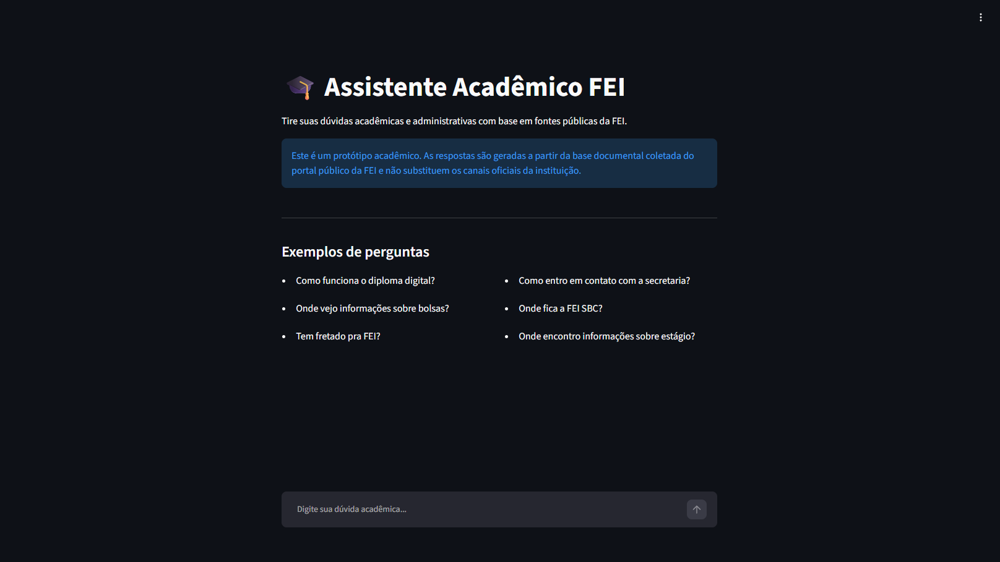
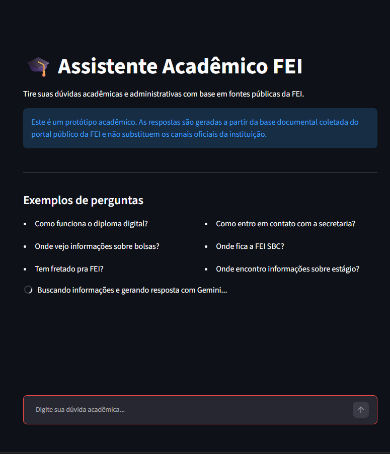
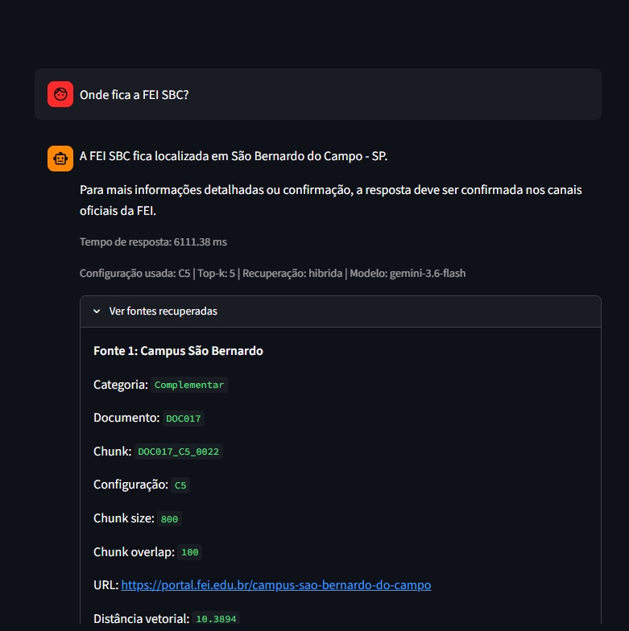
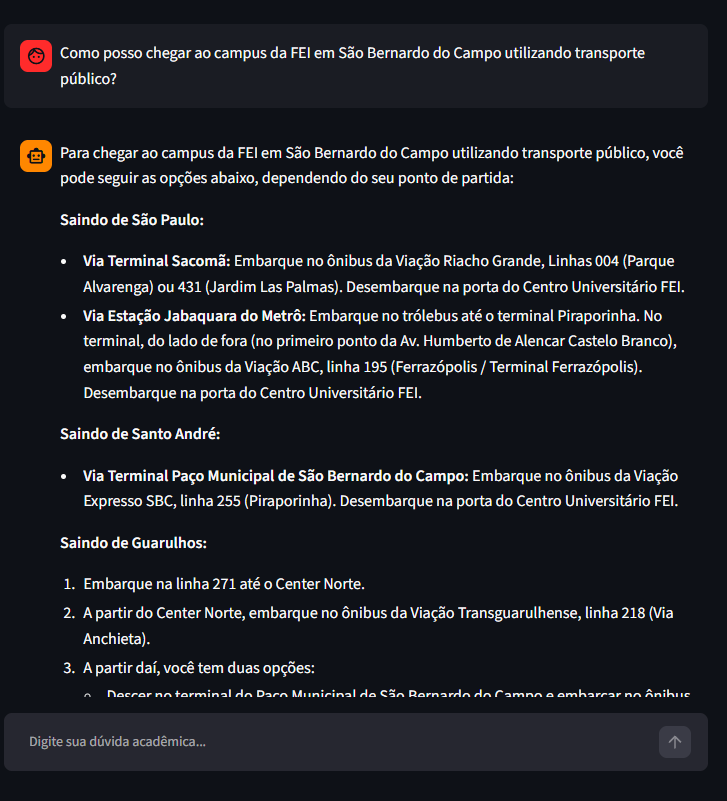
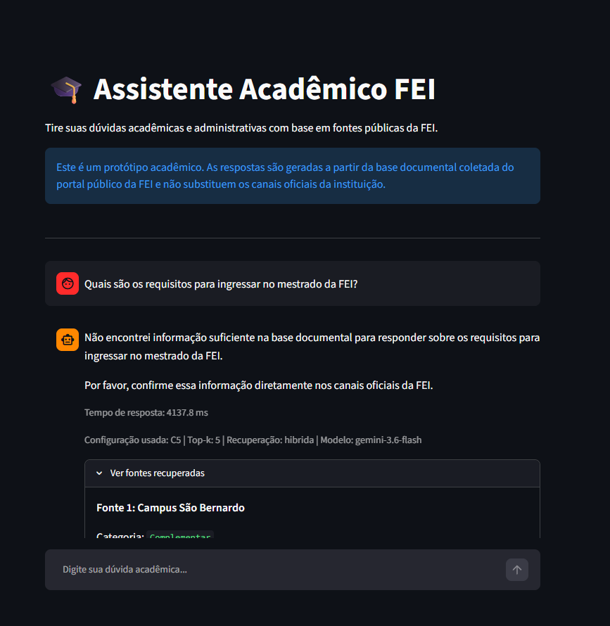
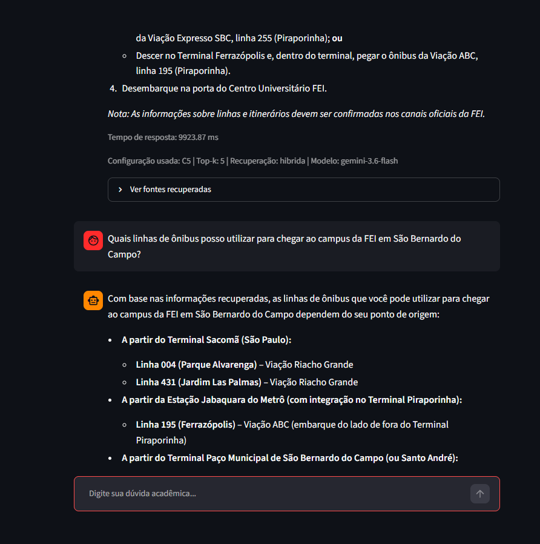

# Entrega 6 — Prototipação em papel

**Data:** 27/10/2026  
**Status:** 🟨 em andamento  
**Responsabilidade:** 1 solução integrada por equipe

## Objetivo da atividade

Externalizar rapidamente ideias de interação em baixa fidelidade para explorar alternativas antes de investir em detalhes visuais. O valor da atividade está no **ciclo construir → simular → observar → revisar**, não na beleza do desenho.

## 1. Escopo do protótipo

**Personas:** P01 — Lucas Almeida e P02 — Mariana Costa, definidas na Entrega 3.

**Cenários/tarefas cobertos:** C01 — localização e compreensão de uma informação acadêmica (Lucas); C02 — compreensão do processo de ingresso em um programa de mestrado (Mariana), definidos na Entrega 4. As tarefas abrangem T01 — obter resposta para uma dúvida acadêmica, T02 — formular e enviar uma consulta, T03 — consultar a resposta e verificar as fontes, T04 — realizar uma pergunta complementar e T05 — compreender a ausência de evidências suficientes.

**Objetivos principais:** Permitir que o estudante formule dúvidas acadêmicas ou administrativas em linguagem natural, compreenda as respostas apresentadas pelo assistente virtual, consulte as fontes institucionais utilizadas e continue a conversa quando precisar de esclarecimentos adicionais. Também se busca verificar como a interface comunica situações em que não existem informações suficientes para responder.

O protótipo representa a interface conversacional do Assistente Virtual da FEI, desenvolvido como parte do TCC da equipe.

Para esta entrega, foram aproveitadas capturas da interface funcional do TCC, conforme a possibilidade indicada pelo professor. As capturas foram utilizadas para representar os diferentes estados de interação, permitindo analisar os caminhos percorridos pelo estudante durante a utilização do assistente.

No cenário relacionado a Lucas, foram utilizadas consultas sobre a localização do campus de São Bernardo do Campo e as opções de transporte público para chegar à instituição. Essas consultas exemplificam a busca e a compreensão de informações institucionais por meio da interface.

No cenário de Mariana, foi utilizada uma pergunta sobre os requisitos para ingresso no mestrado da FEI. Como o assistente não encontrou informações suficientes na base documental para responder, essa interação foi utilizada para representar o estado de ausência de evidências.

A proposta concentra-se nas funcionalidades essenciais do assistente, sem acrescentar telas que não estejam diretamente relacionadas às tarefas analisadas.

## 1.1 Possíveis famílias de interface

Escolha apenas o que for coerente com tarefas e cenários. Para TCCs técnicos, o protótipo pode explorar:

- **dashboard** para monitoramento e tomada de decisão;
- **configuração/parametrização** para preparar algoritmo/modelo/processo;
- **entrada/seleção de dados** com validação;
- **acompanhamento de execução** com progresso, fila, cancelamento e recuperação;
- **relatório/resultados** com explicação, gráficos e exportação;
- **histórico** com busca, filtros, ordenação e detalhes;
- **comparação** entre execuções, versões, algoritmos ou períodos;
- **administração** de usuários, papéis, permissões ou entidades do domínio;
- **auditoria/logs** traduzidos para o perfil;
- **alertas/ocorrências** com ação de resposta.

> Não desenhe todas essas telas por obrigação. O objetivo da baixa fidelidade é experimentar a **estrutura da interação** necessária para as tarefas priorizadas.

Para o projeto da equipe, foi escolhida uma interface conversacional, com foco nas seguintes funcionalidades:

- Campo para inserção de perguntas em linguagem natural.
- Botão para envio das consultas.
- Indicação de processamento da pergunta.
- Apresentação das respostas produzidas pelo assistente.
- Identificação das fontes institucionais recuperadas.
- Continuidade visual da conversa por meio de perguntas complementares.
- Mensagens de orientação quando não houver informações suficientes para responder.

Não foram incluídas telas de administração, dashboard ou configuração dos modelos de inteligência artificial como parte dos fluxos de uso do estudante, pois essas funcionalidades não fazem parte das tarefas priorizadas.

## 2. Fluxos escolhidos

| Fluxo | Tarefa/objetivo | Por que foi priorizado |
|---|---|---|
| PF01 | Formular e enviar uma consulta institucional, receber a resposta e verificar as fontes apresentadas. Relacionado às tarefas T01, T02 e T03 e à atividade de consulta representada pelo cenário C01 de Lucas. | Representa a principal interação do estudante com o assistente virtual, permitindo analisar a facilidade de realizar consultas, compreender as respostas e identificar a origem das informações. |
| PF02 | Consultar informações detalhadas sobre como chegar ao campus da FEI em São Bernardo do Campo utilizando transporte público e realizar uma pergunta complementar sobre as linhas de ônibus. Relacionado à continuidade da interação prevista na T04. | Permite observar a apresentação de respostas mais extensas e a possibilidade de realizar novas perguntas sem iniciar outra conversa. |
| PF03 | Consultar informações sobre os requisitos para ingresso no mestrado da FEI e compreender a mensagem apresentada quando não existem evidências documentais suficientes. Relacionado ao cenário C02 de Mariana e à T05. | Permite avaliar como o assistente comunica suas limitações e orienta o estudante quando não consegue fornecer uma resposta fundamentada. |

Os fluxos foram escolhidos por representarem interações relacionadas aos objetivos definidos nas entregas anteriores.

O PF01 representa a interação principal do sistema, utilizando como exemplo uma pergunta sobre a localização da FEI em São Bernardo do Campo.

O PF02 explora a continuidade da conversa em uma consulta sobre transporte público, permitindo observar como perguntas e respostas permanecem apresentadas na mesma interface.

O PF03 representa um caminho alternativo, no qual o assistente não dispõe de informações suficientes sobre os requisitos de ingresso no mestrado. Esse fluxo é importante para avaliar a clareza das mensagens de limitação e a orientação oferecida ao estudante.

## 3. Telas e estados

- Numere as telas/estados (`P01`, `P02`...).
- Indique controles que mudam o estado.
- Mostre pelo menos caminhos principais e estados de erro/retorno relevantes.

O protótipo foi organizado em seis telas ou estados de interação, compartilhados pelos fluxos selecionados.

| Tela/estado | Descrição | Interação e transição |
|---|---|---|
| P01 — Tela inicial | Apresenta a interface principal do assistente, com título, orientação inicial, campo para digitar perguntas e botão de envio. | O estudante escreve sua dúvida e utiliza o botão de envio, avançando para P02. |
| P02 — Processamento da consulta | Apresenta a pergunta enviada e uma indicação visual de que o assistente está processando a solicitação. | Após o processamento, o sistema apresenta a resposta correspondente em P03 ou P04, ou uma mensagem de ausência de evidências em P05. |
| P03 — Resposta institucional com fontes | Apresenta uma resposta à pergunta sobre a localização da FEI em São Bernardo do Campo, acompanhada de fontes institucionais recuperadas. | O estudante lê a resposta e pode expandir a seção "Ver fontes recuperadas" para consultar a origem das informações. |
| P04 — Resposta detalhada sobre transporte público | Apresenta orientações sobre como chegar ao campus da FEI em São Bernardo do Campo, incluindo opções de transporte público a partir de diferentes localidades. | O estudante consulta as orientações e pode enviar uma pergunta complementar, representada em P06. |
| P05 — Ausência de evidências | Apresenta a mensagem informando que o assistente não encontrou informações suficientes sobre os requisitos para ingresso no mestrado da FEI. | O estudante recebe uma orientação para confirmar as informações nos canais oficiais e pode realizar outra consulta. |
| P06 — Continuidade da conversa | Apresenta uma pergunta complementar sobre as linhas de ônibus para chegar ao campus, mantendo a resposta anterior visível na mesma conversa. | O estudante envia uma nova pergunta, passa pelo processamento em P02 e visualiza a nova resposta na sequência da conversa. |

**Fluxo principal — Lucas (PF01):**

1. O estudante acessa o assistente virtual na tela P01.
2. Digita a pergunta "Onde fica a FEI SBC?".
3. Envia a pergunta, passando para P02.
4. Aguarda o processamento da consulta.
5. Recebe a resposta informando que a FEI SBC está localizada em São Bernardo do Campo, na tela P03.
6. Expande a seção "Ver fontes recuperadas".
7. Identifica a fonte institucional relacionada ao Campus São Bernardo e o endereço para consulta no portal da FEI.
8. Caso precise de informações adicionais, pode enviar uma nova pergunta pela interface.

**Fluxo complementar — Transporte público (PF02):**

1. O estudante acessa o assistente virtual na tela P01.
2. Digita a pergunta "Como posso chegar ao campus da FEI em São Bernardo do Campo utilizando transporte público?".
3. Envia a pergunta, passando para P02.
4. Aguarda o processamento da consulta.
5. Recebe uma resposta detalhada na tela P04, contendo orientações de transporte público a partir de diferentes localidades, incluindo São Paulo, Santo André e Guarulhos.
6. Após consultar a resposta, digita a pergunta "Quais linhas de ônibus posso utilizar para chegar ao campus da FEI em São Bernardo do Campo?".
7. A nova pergunta é processada e a resposta aparece na sequência da mesma conversa, conforme representado em P06.

**Fluxo alternativo — Ausência de evidências (PF03):**

1. A estudante Mariana acessa o assistente virtual pela tela P01.
2. Digita a pergunta "Quais são os requisitos para ingressar no mestrado da FEI?".
3. Envia a consulta, passando para P02.
4. Aguarda o processamento da pergunta.
5. O assistente informa que não encontrou informações suficientes na base documental para responder sobre os requisitos para ingresso no mestrado.
6. A mensagem apresentada na tela P05 orienta a estudante a confirmar a informação diretamente nos canais oficiais da FEI.
7. A estudante pode formular outra pergunta utilizando o campo de entrada disponível na interface.

**Estados de erro e retorno:**

- O campo de entrada e o botão de envio permitem ao estudante formular novas consultas.
- Durante o processamento, a interface apresenta uma indicação visual de que a pergunta está sendo processada.
- Quando não existem evidências suficientes, o assistente apresenta uma mensagem informando essa limitação e orientando a confirmação nos canais oficiais.
- A interface mantém as mensagens anteriores visíveis durante a sessão, permitindo realizar novas perguntas sem iniciar outra conversa.
- A continuidade visual das mensagens não significa, necessariamente, que o modelo utiliza todo o histórico anterior para gerar suas respostas. Essa característica deverá ser considerada nas avaliações posteriores.

**Protótipo — Visão geral dos fluxos:**

**P01 — Tela inicial do assistente**

Representa o primeiro contato do estudante com o Assistente Acadêmico FEI, apresentando o título da aplicação, as orientações iniciais e o campo destinado à inserção de perguntas em linguagem natural.

**P02 — Processamento da consulta**

Representa o estado da interface após o envio de uma pergunta, indicando que o assistente está processando a solicitação antes de apresentar a resposta.

**P03 — Resposta institucional com fontes**

Representa a resposta à pergunta "Onde fica a FEI SBC?", informando a localização do campus em São Bernardo do Campo.

A captura também apresenta a seção "Ver fontes recuperadas", por meio da qual o estudante pode consultar referências institucionais, incluindo o endereço da página do Campus São Bernardo no portal da FEI.

**P04 — Resposta detalhada sobre transporte público**

Representa a resposta à pergunta "Como posso chegar ao campus da FEI em São Bernardo do Campo utilizando transporte público?".

O assistente apresenta diferentes possibilidades de acesso ao campus, organizando orientações de transporte conforme a localidade de origem do estudante.

Essa tela permite observar a apresentação de respostas mais extensas e a organização das informações para facilitar sua leitura.

**P05 — Ausência de evidências suficientes**

Representa a consulta sobre os requisitos para ingresso no mestrado da FEI.

Nesse caso, o assistente informa que não encontrou informações suficientes na base documental para responder à pergunta e orienta que o estudante confirme os requisitos diretamente nos canais oficiais da instituição.

Esse estado demonstra o comportamento da interface diante de uma consulta que não pôde ser respondida com as evidências recuperadas.

**P06 — Continuidade da conversa**

Representa a realização de uma pergunta complementar após a consulta sobre transporte público.

O estudante pergunta "Quais linhas de ônibus posso utilizar para chegar ao campus da FEI em São Bernardo do Campo?", recebendo uma nova resposta na mesma conversa.

A captura mostra parte da resposta anterior e a nova interação, demonstrando como as mensagens permanecem organizadas no histórico da sessão.

## 4. Simulação / walkthrough

Realize uma simulação com uma pessoa que não participou da elaboração dessas telas. Um colega pode ser usado **para essa iteração formativa**, mas isso não substitui os participantes finais da Entrega 14.

A simulação será realizada com uma pessoa que não participou da elaboração do protótipo, utilizando os fluxos definidos na seção 2.

O objetivo é observar se a pessoa consegue compreender a interface e realizar as tarefas propostas sem receber instruções detalhadas sobre cada ação.

Para a simulação, foram definidos três cenários de utilização.

**Cenário 1 — Consulta institucional (PF01):**

O participante deverá utilizar o protótipo para descobrir onde fica o campus da FEI em São Bernardo do Campo, interpretar a resposta apresentada e identificar a fonte institucional utilizada pelo assistente.

Será observado se o participante consegue localizar o campo para digitar a pergunta, compreender a resposta e encontrar a seção "Ver fontes recuperadas".

**Cenário 2 — Consulta sobre transporte público (PF02):**

O participante deverá utilizar o protótipo para consultar como chegar ao campus da FEI utilizando transporte público.

Após receber a resposta inicial, deverá realizar uma pergunta complementar sobre as linhas de ônibus disponíveis.

Será observado se o participante consegue acompanhar as orientações apresentadas, localizar o campo para enviar uma nova pergunta e compreender a continuidade da conversa.

**Cenário 3 — Ausência de informações sobre mestrado (PF03):**

O participante deverá utilizar o protótipo para consultar quais são os requisitos para ingresso no mestrado da FEI.

Como o estado registrado apresenta ausência de evidências suficientes, será observado se o participante compreende a limitação comunicada pelo assistente e identifica como poderia continuar sua busca por informações.

Durante o walkthrough, um integrante da equipe ficará responsável por apresentar os estados da interface conforme as ações indicadas pelo participante, enquanto o outro registrará dificuldades, dúvidas e comentários observados.

A simulação deverá considerar principalmente a localização dos controles, a compreensão das respostas, a identificação das fontes e a possibilidade de recuperação após uma consulta sem resultado conclusivo.

**Registro da simulação:**

- **Participante:** {{preencher após a realização}}
- **Data:** {{dd/mm/aaaa}}
- **Modalidade:** {{presencial/remota}}
- **Responsáveis:** Matheus Dourado Valle e João Pedro Sabino Garcia.

| Observação | Tela/ação | Evidência | Consequência para o design |
|---|---|---|---|
| {{Registrar a observação real sobre a realização da primeira consulta.}} | P01 / P02 | {{Registrar ação, dúvida ou comentário observado.}} | {{Indicar a decisão tomada com base na observação.}} |
| {{Registrar a observação real sobre a compreensão da resposta e a localização das fontes institucionais.}} | P03 | {{Registrar ação, dúvida ou comentário observado.}} | {{Indicar a decisão tomada com base na observação.}} |
| {{Registrar a observação real sobre a consulta de transporte e a continuidade da conversa.}} | P04 / P06 | {{Registrar ação, dúvida ou comentário observado.}} | {{Indicar a decisão tomada com base na observação.}} |
| {{Registrar a observação real sobre a compreensão da mensagem de ausência de evidências.}} | P05 | {{Registrar ação, dúvida ou comentário observado.}} | {{Indicar a decisão tomada com base na observação.}} |

Os campos de observação, evidência e consequência serão preenchidos após a realização da simulação, utilizando os comportamentos efetivamente observados. As situações descritas anteriormente constituem o roteiro planejado, não resultados já obtidos.

## 5. Alterações após a simulação

As alterações no protótipo serão definidas após a realização do walkthrough, considerando as dificuldades identificadas durante a interação do participante com os estados apresentados.

As revisões deverão priorizar aspectos relacionados à clareza das informações, à identificação dos controles de interação, à apresentação das fontes institucionais e à possibilidade de continuar ou reformular consultas.

Também poderão ser avaliados aspectos observados na interface existente, como a quantidade de informações técnicas apresentadas na seção de fontes recuperadas e a clareza da orientação fornecida quando não existem evidências suficientes.

| Antes | Problema | Depois | Justificativa |
|---|---|---|---|
| {{Descrever como o elemento estava apresentado na versão inicial.}} | {{Registrar o problema identificado durante a simulação.}} | {{Descrever a alteração aplicada ao protótipo.}} | {{Explicar como a alteração atende ao problema observado.}} |

**Protótipo revisado após a simulação:**

As alterações realizadas deverão ser representadas na versão revisada do protótipo e relacionadas às observações registradas na seção anterior.

Dessa maneira, a equipe poderá demonstrar a aplicação do ciclo construir, simular, observar e revisar, previsto no objetivo da atividade.

## Checklist

- [x] O protótipo cobre tarefas relevantes da Entrega 5.
- [x] Cada tela/estado pode ser justificado por uma tarefa, decisão ou informação necessária.
- [x] O projeto não criou dashboard/CRUD/login apenas para parecer “completo”.
- [ ] Telas/estados estão numerados e navegáveis na documentação.
- [ ] Há pelo menos uma simulação/walkthrough documentado.
- [ ] Críticas não foram apenas listadas: geraram decisão de revisão.
- [ ] O protótipo continua em baixa fidelidade; detalhes visuais não mascaram problemas de fluxo.
