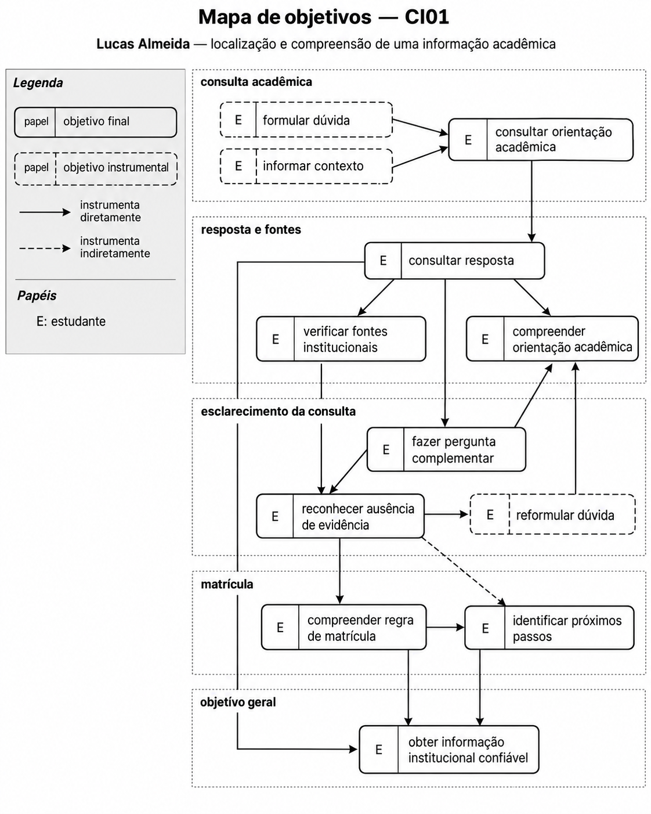

# Entrega 9 — Modelo conceitual e design centrado na comunicação

**Data:** 24/10/2026  
**Status:** 🟨 em andamento  
**Responsabilidade:** soluções individuais, com consolidação da equipe para mapa de objetivos e esquema de signos.

## Objetivo da atividade

Passar do cenário de problema para uma concepção da interação, explicitando objetivos, tópicos de conversa, falas e signos que a interface deverá comunicar/manipular.

## Transformando resultados técnicos em conceitos compreensíveis

Em TCCs algorítmicos ou orientados a dados, esta entrega deve evitar que a interface exponha apenas estruturas internas do código. Identifique os **conceitos e signos que fazem sentido para o usuário**.

Exemplos:

- `query plan`, custo estimado, recomendação e impacto para um DBA;
- modelo, dataset, versão, execução e métrica para engenheiro de IA;
- período, indicador, grupo, tendência e filtro para gestor/analista;
- alerta, severidade, evidência, responsável e status para analista de segurança.

Se um termo técnico for necessário, modele como será comunicado, explicado e relacionado à tarefa.

Dashboards, relatórios, filtros e CRUDs devem aparecer no modelo conceitual por meio dos **objetivos, signos e conversas** que justificam sua existência.

## 1. Cenários de interação

Para cada cenário de problema, produza uma versão em que a solução já pode ser descrita. **Destaque claramente o texto alterado** em relação ao cenário original.

### CI01 — Localização e compreensão de uma informação acadêmica

**Autor(a):** Matheus Dourado Valle — 22.224.023-6  
**Origem:** cenário problema C01

Lucas Almeida é estudante da FEI e está tentando decidir se fará uma alteração em sua matrícula naquele período do semestre. Para tomar essa decisão, ele precisa confirmar se a orientação institucional sobre o tema realmente se aplica à sua situação.

A necessidade surge durante um intervalo entre atividades no campus, quando Lucas percebe que precisa resolver aquela dúvida no mesmo dia para decidir se mantém sua organização atual do semestre ou se busca outra alternativa.

O que ele precisa descobrir não é apenas alguma informação sobre matrícula, mas especificamente qual ação acadêmica é possível naquele período e se a orientação institucional vale para o caso que está vivendo.

**Em vez de iniciar a busca por diferentes páginas e documentos institucionais, Lucas utiliza o assistente virtual da FEI para apresentar sua dúvida em linguagem natural, explicando brevemente a situação relacionada à sua matrícula.**

**O assistente recebe a consulta e informa que está procurando conteúdos institucionais relacionados ao assunto. Após a busca, apresenta uma resposta organizada em linguagem compreensível, acompanhada das fontes utilizadas para fundamentar a orientação.**

**Lucas analisa a resposta e consulta as referências institucionais apresentadas para verificar se a informação corresponde ao período acadêmico atual e à situação que está tentando resolver.**

**Ao perceber que uma expressão institucional ainda não está suficientemente clara, ele realiza uma pergunta complementar, solicitando um esclarecimento sobre a aplicação daquela orientação ao seu caso.**

**O assistente considera o contexto da conversa anterior e procura esclarecer a dúvida com base nas informações institucionais disponíveis, evitando que Lucas precise repetir toda a consulta.**

**Caso não existam evidências suficientes para confirmar uma condição específica, o assistente comunica essa limitação e orienta Lucas a buscar confirmação no canal institucional responsável, sem apresentar uma conclusão não fundamentada.**

Lucas entende que a atividade foi concluída com sucesso quando consegue explicar para si mesmo qual orientação se aplica ao seu caso, qual fonte institucional sustenta essa interpretação e o que deve fazer a seguir com base nisso.

### Diferenças relevantes

| Alteração | Por que foi necessária | Evidência/artefato que justifica |
|---|---|---|
| Consulta em linguagem natural pelo assistente virtual | Reduzir a necessidade de procurar manualmente informações distribuídas por diferentes canais institucionais. | Entrega 4 — C01; Entrega 1 — A01 e R01. |
| Comunicação do andamento da consulta | Permitir que o estudante compreenda que sua pergunta está sendo processada. | Entrega 6 — protótipo em papel. |
| Apresentação de resposta acompanhada de fontes | Facilitar a compreensão da orientação e permitir a verificação de sua origem. | Entrega 4 — C01, Q4, Q5 e Q7; Entrega 5 — análise de tarefas. |
| Possibilidade de pergunta complementar | Permitir o esclarecimento de dúvidas sem reiniciar a consulta. | Entrega 5 — modelos HTA, GOMS e CTT; Entrega 6 — protótipo conversacional. |
| Comunicação de ausência de evidência | Evitar que informações insuficientes sejam apresentadas como orientações confirmadas. | Entrega 4 — C01, Q5 e Q7; Entrega 6 — estado sem evidência. |

## 2. Design centrado na comunicação

**Nome do cenário:** CI01 — Localização e compreensão de uma informação acadêmica

| Tópico > subtópico | Falas e signos envolvidos | Intenção/efeito esperado |
|---|---|---|
| Consultar orientação acadêmica | `U: Preciso entender uma regra sobre alteração de matrícula neste semestre.` | Iniciar uma consulta acadêmica. Signos: dúvida, assunto acadêmico. |
| > Informar dúvida | `D: Qual orientação você precisa confirmar?` / `U: Quero saber se posso fazer uma alteração na minha matrícula neste período.` | Identificar a necessidade específica do estudante. Signos: dúvida, alteração de matrícula, período acadêmico. |
| > Consultar informações institucionais | `D: Vou consultar as informações institucionais disponíveis sobre esse assunto.` | Comunicar o andamento da consulta. Signo: estado da consulta. |
| > Apresentar orientação | `D: Encontrei informações relacionadas à sua dúvida. Vou apresentar a orientação disponível e indicar as fontes utilizadas.` | Permitir que o estudante compreenda a informação encontrada. Signos: resposta, orientação acadêmica. |
| > Verificar fontes | `U: De onde veio essa informação?` / `D: Estas são as fontes institucionais utilizadas para fundamentar a resposta.` | Permitir a verificação da origem da informação. Signo: fonte institucional. |
| > Esclarecer dúvida | `U: Essa regra também vale para a minha situação?` / `D: Vou considerar sua pergunta anterior e verificar se as informações disponíveis permitem esclarecer essa condição.` | Facilitar a continuidade da conversa. Signos: pergunta complementar, contexto da conversa. |
| > Tratar informação insuficiente | `D: Não encontrei informações suficientes para confirmar essa condição específica. Recomendo buscar confirmação no setor institucional responsável.` | Comunicar limitações e orientar uma alternativa. Signos: ausência de evidência, orientação de encaminhamento. |
| > Concluir consulta | `U: Agora consigo compreender a orientação e identificar o que preciso verificar antes de decidir.` | Reconhecer o resultado da consulta. Signos: resposta, fonte institucional. |

**Convenção:** `U` = usuário; `D` = preposto do designer/sistema, conforme a abordagem de Engenharia Semiótica adotada na disciplina.

## 3. Mapa de objetivos

Cada integrante apresenta seu mapa e a equipe cria um **mapa consolidado**, eliminando duplicidades e resolvendo conflitos de nomenclatura.

**Mapa individual — Matheus Dourado Valle**

**Mapa consolidado — Equipe**

### Dicionário de objetivos

| ID | Objetivo | Persona(s) | Cenário(s) | Prioridade |
|---|---|---|---|---|
| O01 | Obter informação institucional confiável | P01 | CI01 | Alta |
| O02 | Formular uma dúvida em linguagem natural | P01 | CI01 | Alta |
| O03 | Informar o contexto da situação acadêmica | P01 | CI01 | Alta |
| O04 | Compreender a orientação institucional apresentada | P01 | CI01 | Alta |
| O05 | Verificar as fontes institucionais da resposta | P01 | CI01 | Alta |
| O06 | Esclarecer dúvidas complementares | P01 | CI01 | Alta |
| O07 | Reconhecer quando não existem evidências suficientes | P01 | CI01 | Alta |
| O08 | Identificar os próximos passos para sua decisão | P01 | CI01 | Alta |
| O09 | Compreender a aplicação de uma regra de matrícula | P01 | CI01 | Alta |
| O10 | Acompanhar o andamento da consulta | P01 | CI01 | Média |

## 4. Esquema conceitual de signos

Consolide as informações em **uma tabela única**.

| Grupo | Signo | Origem | Observações/semântica | Tipo de conteúdo | Restrição | Valor padrão | Prevenção | Recuperação |
|---|---|---|---|---|---|---|---|---|
| Consulta | Dúvida | Usuário | Pergunta formulada pelo estudante sobre um assunto acadêmico ou administrativo. | Texto | Não pode estar vazia para envio. | Vazio | PP: orientar a formulação; PA: impedir envio vazio. | RA: permitir correção e novo envio. |
| Consulta | Assunto acadêmico | Domínio | Tema relacionado à dúvida, como matrícula ou calendário acadêmico. | Texto | Deve corresponder ao assunto consultado. | Não definido | PP: utilizar terminologia compreensível. | RA: permitir esclarecer o assunto. |
| Consulta | Estado da consulta | Aplicação | Comunica o andamento da busca e da elaboração da resposta. | Estado | Deve refletir a situação real da consulta. | Aguardando | PP: informar o andamento. | RA: comunicar falha e permitir nova tentativa. |
| Resposta | Resposta | Aplicação | Orientação apresentada ao estudante com base nas informações recuperadas. | Texto | Deve respeitar as evidências institucionais disponíveis. | Não disponível | PP: apresentar informação clara e indicar limitações. | RA: permitir reformulação da dúvida. |
| Resposta | Fonte institucional | Domínio | Página ou documento que fundamenta uma informação apresentada. | Referência/URL | Deve corresponder a uma fonte efetivamente utilizada. | Não disponível | PP: identificar a origem da informação. | RA: informar indisponibilidade da referência. |
| Resposta | Orientação acadêmica | Domínio | Regra ou procedimento institucional relacionado à dúvida apresentada. | Texto | Deve corresponder às informações institucionais disponíveis. | Não definida | PP: explicar termos institucionais. | RA: permitir solicitar esclarecimentos. |
| Resposta | Ausência de evidência | Aplicação | Informa que não existem dados suficientes para confirmar determinada orientação. | Mensagem/estado | Apresentada quando não houver suporte suficiente. | Não apresentada | PP: comunicar os limites da informação. | RA: orientar reformulação ou confirmação institucional. |
| Resposta | Orientação de encaminhamento | Aplicação | Indicação de alternativa para confirmar uma informação não esclarecida. | Texto/referência | Deve evitar indicar contatos não confirmados. | Não apresentada | PP: diferenciar orientação e confirmação institucional. | CE: indicar alternativa externa quando necessário. |
| Conversa | Pergunta complementar | Usuário | Nova dúvida relacionada à consulta anterior. | Texto | Deve permitir continuidade do contexto. | Vazio | PP: comunicar a possibilidade de continuidade. | RA: permitir reformular a pergunta. |
| Conversa | Contexto da conversa | Aplicação | Informações anteriores utilizadas para interpretar perguntas complementares. | Sequência de mensagens | Limitado ao contexto disponível. | Conversa atual | PP: indicar quando o contexto não estiver disponível. | RA: solicitar informações necessárias. |
| Matrícula | Período acadêmico | Domínio | Referência temporal utilizada para interpretar a orientação. | Texto/período | Deve estar associado à fonte institucional consultada. | Não definido | PP: explicitar o período quando disponível. | RA: orientar confirmação da vigência. |
| Matrícula | Alteração de matrícula | Domínio | Procedimento acadêmico relacionado à decisão de Lucas. | Texto/conceito | Deve respeitar a terminologia institucional. | Não definido | PP: explicar o procedimento. | RA: solicitar esclarecimento sobre a situação. |

### Regras para os signos

- Use o vocabulário do domínio do usuário.
- Evite duplicar o mesmo conceito com nomes diferentes.
- Diferencie informação fornecida pelo usuário, produzida pelo sistema e derivada do domínio.
- Registre prevenção e recuperação apenas quando fizer sentido; explique as siglas usadas.

**Siglas utilizadas:**

- **PP — Prevenção Passiva:** apresenta explicações ou orientações para evitar rupturas comunicativas.
- **PA — Prevenção Ativa:** impede ações inválidas durante a interação.
- **AL — Prevenção Apoiada (Alerta):** comunica uma situação potencialmente problemática e solicita uma decisão informada.
- **RA — Recuperação Apoiada:** auxilia o usuário a corrigir problemas após sua ocorrência.
- **CE — Captura de Erro:** comunica situações que não podem ser resolvidas diretamente pela interface e indica, quando possível, alternativas externas.

## Síntese

Quais objetivos/tópicos/signos deverão necessariamente aparecer nos diagramas MoLIC?

Considerando o cenário CI01, os diagramas MoLIC deverão representar os objetivos de formular uma dúvida acadêmica, compreender a orientação apresentada, verificar suas fontes e realizar perguntas complementares.

Os principais tópicos de conversa são:

- Consultar orientação acadêmica.
- Informar dúvida sobre matrícula.
- Consultar informações institucionais.
- Apresentar e compreender a orientação.
- Verificar fontes institucionais.
- Esclarecer dúvidas complementares.
- Tratar ausência de evidência.
- Concluir consulta.

Os signos essenciais são: dúvida, assunto acadêmico, estado da consulta, resposta, fonte institucional, orientação acadêmica, ausência de evidência, orientação de encaminhamento, pergunta complementar, contexto da conversa, período acadêmico e alteração de matrícula.

Os diagramas também deverão considerar situações em que a consulta apresenta uma falha, a informação encontrada não esclarece completamente a dúvida ou não existem evidências suficientes para confirmar uma orientação.

Esses elementos serão utilizados na Entrega 10, preservando os mesmos nomes definidos no dicionário de objetivos e no esquema conceitual de signos.

## Checklist

- [x] Cenários de interação mostram alterações em relação aos cenários de problema.
- [x] Cada solução individual identifica autor e cenário de origem.
- [x] Tópicos/falas/signos são coerentes com objetivos do usuário.
- [ ] Mapas individuais foram consolidados.
- [ ] O esquema de signos está em uma tabela única e sem duplicações conceituais.
- [ ] Nomes de objetivos/signos serão reutilizados na Entrega 10.
- [x] Em TCC técnico, signos representam conceitos do domínio compreensíveis ao usuário, não apenas variáveis/estruturas internas.
- [x] Padrões como dashboard, relatório, filtros, administração e CRUD possuem objetivos e signos correspondentes.
- [x] A interface comunica não só o resultado técnico, mas também seu significado para a tarefa.
