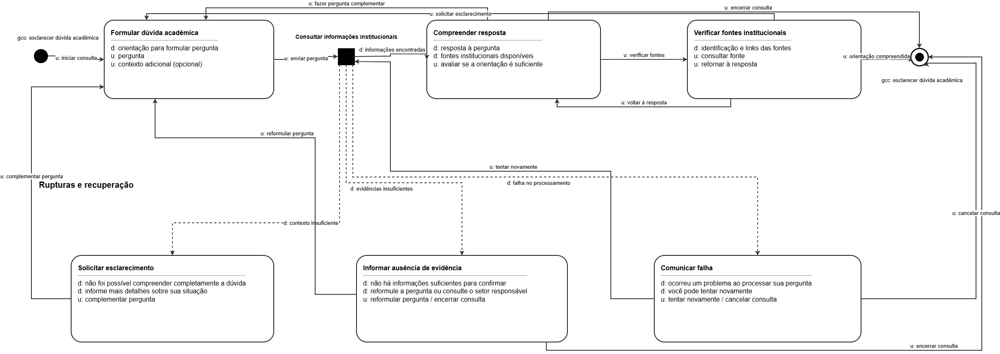
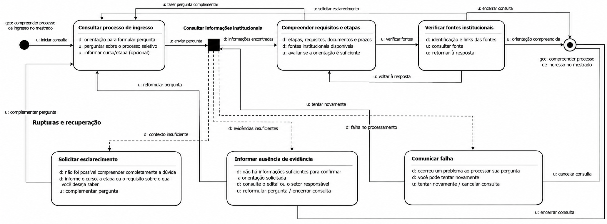

# Entrega 10 — MoLIC

**Data:** {{30/10/2026}}  
**Status:** 🟩 Concluída 
**Responsabilidade:** 1 solução completa por integrante

## Objetivo da atividade

Modelar a interação como uma **conversa entre usuário e preposto do designer**, oferecendo visão global dos caminhos que permitem ao usuário atingir seus objetivos — incluindo alternativas e rupturas relevantes. MoLIC não deve ser reduzida a um fluxograma de telas.

> Use a **notação MoLIC ensinada na disciplina**. Este template foca critérios de qualidade e não substitui a legenda/notação apresentada em aula.

## Atenção a TCCs sem interface original

O MoLIC não modela o algoritmo por dentro. Ele modela a **conversa de interação necessária para que uma pessoa use a contribuição**.

Exemplos de conversas:

- usuário escolhe dados/parâmetros → sistema valida → usuário inicia análise → sistema comunica processamento → usuário interpreta resultado;
- usuário consulta histórico → refina filtros → abre execução → compara com outra;
- administrador seleciona perfil → altera permissão → sistema comunica consequências → administrador confirma/cancela;
- analista recebe alerta → examina evidências → classifica ocorrência → registra decisão.

Modele também rupturas plausíveis: entrada inválida, falha de processamento, ausência de resultado, permissão insuficiente, filtro sem resultados, conflito de alteração, cancelamento ou necessidade de recuperação.

## M01 — Consultar e compreender uma informação acadêmica ou administrativa

**Autor(a):** Matheus Dourado Valle — 22.224.023-6  
**Cenário de interação de origem:** C01 — Localizar e compreender uma informação acadêmica ou administrativa.  
**Objetivo(s):** Obter resposta para uma dúvida acadêmica ou administrativa, compreender a orientação apresentada e verificar as fontes institucionais utilizadas pelo assistente.  
**Tarefa(s) relacionada(s):** T01 — Obter resposta para uma dúvida acadêmica; T02 — Formular e enviar uma consulta ao assistente; T03 — Consultar a resposta e verificar as fontes apresentadas.  
**Persona relacionada:** P01 — Lucas Almeida.  
**Signos relevantes:** Pergunta, contexto da dúvida, resposta, fonte institucional e ausência de evidência.

### Diagrama

### Leitura do diagrama

O diagrama representa a interação de um estudante com o Assistente Virtual FEI para consultar e compreender informações acadêmicas ou administrativas. A conversa permite formular uma dúvida, receber uma resposta fundamentada em informações institucionais, verificar as fontes apresentadas e realizar perguntas complementares quando necessário.

Além do caminho principal, o modelo apresenta situações em que a pergunta não possui contexto suficiente, não são encontradas evidências institucionais ou ocorre uma falha durante o processamento. Nessas situações, o assistente comunica o problema e oferece alternativas para continuar ou encerrar a interação.

#### Caminho principal

1. O estudante acessa o assistente virtual e inicia uma conversa para esclarecer uma dúvida acadêmica ou administrativa.
2. Na cena "Formular dúvida acadêmica", o estudante escreve sua pergunta e pode fornecer informações adicionais para contextualizar a situação.
3. Ao enviar a pergunta, o sistema realiza o processamento da consulta e busca informações nas fontes institucionais disponíveis.
4. Quando são encontradas informações suficientes, o assistente apresenta uma resposta acompanhada das fontes utilizadas.
5. Na cena "Compreender resposta", o estudante analisa a orientação recebida e avalia se ela atende à sua necessidade.
6. Caso deseje verificar a origem das informações, o estudante acessa a cena "Verificar fontes institucionais", na qual pode consultar os links e documentos apresentados.
7. Após verificar as fontes, o estudante pode retornar à resposta, solicitar esclarecimentos ou encerrar a consulta quando compreender a orientação.
8. Caso ainda tenha dúvidas, o estudante pode formular uma pergunta complementar e continuar a interação.

#### Alternativas e rupturas

| Situação | Onde ocorre | Como o usuário percebe | Caminho de recuperação/saída |
|---|---|---|---|
| Pergunta pouco clara ou sem contexto | Processamento da consulta | O assistente informa que não conseguiu compreender completamente a dúvida e solicita mais detalhes. | O estudante complementa a pergunta e retorna à cena "Formular dúvida acadêmica". |
| Ausência de evidência institucional | Consulta às informações disponíveis | O assistente comunica que não encontrou informações suficientes para confirmar uma resposta. | O estudante pode reformular a pergunta, consultar o setor responsável ou encerrar a consulta. |
| Falha no processamento | Processamento da pergunta | O sistema informa que ocorreu um problema durante a consulta. | O estudante pode tentar novamente ou cancelar a consulta. |
| Resposta insuficiente | Cena "Compreender resposta" | O estudante percebe que a orientação recebida não esclareceu completamente sua dúvida. | O estudante formula uma pergunta complementar e retorna à cena "Formular dúvida acadêmica". |
| Necessidade de esclarecimento sobre as fontes | Cena "Verificar fontes institucionais" | O estudante consulta as fontes, mas ainda precisa compreender melhor a informação apresentada. | O estudante pode retornar à resposta ou solicitar esclarecimentos por meio de uma nova pergunta. |
| Cancelamento da consulta | Durante a interação | O estudante decide interromper a conversa antes de concluir seu objetivo. | O estudante encerra a consulta sem precisar finalizar a tarefa. |

### Checklist específico de modelagem

- [x] Existe **ponto de abertura** coerente com o início do objetivo.
- [x] As **cenas de conversa** representam tópicos/assuntos, não nomes de páginas apenas.
- [x] As transições/falas deixam claro o que o usuário ou o sistema comunica.
- [x] Há **ponto(s) de encerramento** para objetivos concluídos/abandonados quando aplicável.
- [x] Processamentos do sistema estão representados conforme a notação adotada em aula, sem “inventar” fala do usuário.
- [x] Rupturas (breakdowns) relevantes têm feedback e caminho de recuperação, não becos sem saída.
- [x] Acessos ubíquos/atalhos só aparecem quando semanticamente justificáveis.
- [x] O diagrama cobre caminhos alternativos importantes, e não apenas o “happy path”.
- [x] Nomes de objetivos, tópicos e signos são coerentes com a Entrega 9.
- [x] O diagrama é legível em tamanho normal no GitHub.
- [x] O MoLIC representa a conversa usuário–sistema, não o fluxo interno do algoritmo.
- [x] Processamento, filtros, administração, relatórios e históricos incluem retornos/rupturas quando relevantes.

## M02 — Compreender o processo de ingresso no mestrado

**Autor(a):** João Pedro Sabino Garcia — 22.224.032-7  
**Cenário de interação de origem:** C02 — Compreender o processo de ingresso no mestrado da FEI.  
**Objetivo(s):** Compreender as etapas do processo de ingresso no mestrado, identificar os requisitos e documentos necessários, verificar as informações institucionais e esclarecer dúvidas específicas sobre o procedimento.  
**Tarefa(s) relacionada(s):** T04 — Compreender etapas, requisitos e prazos; T05 — Confirmar um requisito específico; T06 — Interpretar a orientação recebida e identificar os próximos passos.  
**Persona relacionada:** P02 — Mariana Costa.  
**Signos relevantes:** Pergunta, contexto da dúvida, resposta, fonte institucional, processo seletivo, requisitos, documentos necessários, prazos e ausência de evidência.

### Diagrama

### Leitura do diagrama

O diagrama representa a interação de uma estudante com o Assistente Virtual FEI para compreender o processo de ingresso no mestrado. A conversa permite consultar informações sobre etapas, requisitos, documentos necessários e prazos, além de verificar as fontes institucionais utilizadas pelo assistente.

Além do caminho principal, o modelo considera situações em que a pergunta não possui contexto suficiente, não são encontradas evidências institucionais sobre determinado requisito ou prazo, ou ocorre uma falha durante o processamento. Nessas situações, o assistente comunica o problema e oferece alternativas para continuar ou encerrar a interação.

#### Caminho principal

1. A estudante acessa o assistente virtual e inicia uma conversa para esclarecer dúvidas sobre o processo de ingresso no mestrado da FEI.
2. Na cena "Consultar processo de ingresso", a estudante formula uma pergunta sobre o processo seletivo, podendo informar o curso ou a etapa sobre a qual deseja obter informações.
3. Ao enviar a pergunta, o sistema realiza o processamento da consulta e busca informações nas fontes institucionais disponíveis.
4. Quando são encontradas informações suficientes, o assistente apresenta uma resposta relacionada ao processo de ingresso, incluindo etapas, requisitos, documentos ou prazos, conforme a pergunta realizada e as evidências disponíveis.
5. Na cena "Compreender requisitos e etapas", a estudante analisa as orientações recebidas e verifica se conseguiu compreender as informações necessárias.
6. Caso deseje confirmar um requisito, documento ou prazo específico, a estudante pode formular uma pergunta complementar e continuar a conversa.
7. Na cena "Verificar fontes institucionais", a estudante pode consultar os links e documentos apresentados pelo assistente para confirmar a origem das informações.
8. Após consultar as fontes, a estudante pode retornar à resposta, solicitar novos esclarecimentos ou identificar os próximos passos para participar do processo seletivo.
9. Caso as orientações sejam suficientes, a estudante encerra a consulta com seu objetivo atendido. Também pode interromper a conversa sem concluir seu objetivo.

#### Alternativas e rupturas

| Situação | Onde ocorre | Como o usuário percebe | Caminho de recuperação/saída |
|---|---|---|---|
| Pergunta pouco clara ou sem contexto | Processamento da consulta | O assistente informa que precisa de mais detalhes sobre o curso, requisito ou etapa do processo seletivo. | A estudante complementa a pergunta e retorna à cena "Consultar processo de ingresso". |
| Ausência de evidência institucional | Consulta às informações disponíveis | O assistente comunica que não encontrou informações suficientes para confirmar uma orientação. | A estudante pode reformular a pergunta, consultar o setor responsável ou encerrar a consulta. |
| Requisito ou documento não identificado | Cena "Compreender requisitos e etapas" | A estudante percebe que não conseguiu confirmar uma exigência ou documento necessário. | A estudante formula uma pergunta complementar ou consulta as fontes institucionais disponíveis. |
| Prazo não localizado | Consulta sobre o processo seletivo | O assistente informa que não encontrou evidências suficientes sobre o prazo solicitado. | A estudante pode consultar o edital ou o setor responsável pelo processo seletivo. |
| Resposta insuficiente | Cena "Compreender requisitos e etapas" | A estudante percebe que a orientação não esclareceu completamente sua dúvida. | A estudante formula uma pergunta complementar e continua a conversa. |
| Necessidade de esclarecimento sobre as fontes | Cena "Verificar fontes institucionais" | A estudante consulta as fontes, mas ainda precisa compreender melhor determinada informação. | A estudante pode retornar à resposta ou solicitar novos esclarecimentos. |
| Falha no processamento | Processamento da pergunta | O sistema informa que ocorreu um problema durante a consulta. | A estudante pode tentar novamente ou cancelar a consulta. |
| Cancelamento da consulta | Durante a interação | A estudante decide interromper a conversa antes de concluir seu objetivo. | A estudante encerra a consulta sem precisar finalizar a tarefa. |

### Checklist específico de modelagem

- [x] Existe **ponto de abertura** coerente com o início do objetivo.
- [x] As **cenas de conversa** representam tópicos/assuntos, não nomes de páginas apenas.
- [x] As transições/falas deixam claro o que o usuário ou o sistema comunica.
- [x] Há **ponto(s) de encerramento** para objetivos concluídos/abandonados quando aplicável.
- [x] Processamentos do sistema estão representados conforme a notação adotada em aula, sem “inventar” fala do usuário.
- [x] Rupturas (breakdowns) relevantes têm feedback e caminho de recuperação, não becos sem saída.
- [x] Acessos ubíquos/atalhos só aparecem quando semanticamente justificáveis.
- [x] O diagrama cobre caminhos alternativos importantes, e não apenas o “happy path”.
- [x] Nomes de objetivos, tópicos e signos são coerentes com a Entrega 9.
- [x] O diagrama é legível em tamanho normal no GitHub.
- [x] O MoLIC representa a conversa usuário–sistema, não o fluxo interno do algoritmo.
- [x] Processamento, filtros, administração, relatórios e históricos incluem retornos/rupturas quando relevantes.

## Consolidação da equipe

### Cobertura dos objetivos

| Objetivo | MoLIC que cobre | Lacunas/duplicidades | Decisão |
|---|---|---|---|
| O01 — Obter informação institucional confiável | M01 e M02 | Objetivo presente nos dois modelos, aplicado a diferentes necessidades acadêmicas. | Manter em ambos os modelos. |
| O02 — Formular dúvida | M01 e M02 | Os dois modelos apresentam uma cena de formulação de perguntas. | Manter em ambos os modelos. |
| O03 — Informar contexto | M01 e M02 | O estudante pode fornecer contexto adicional para esclarecer sua necessidade. | Manter os caminhos de complementação da pergunta. |
| O04 — Compreender orientação | M01 e M02 | Ambos permitem interpretar a resposta apresentada pelo assistente. | Manter as cenas de compreensão da resposta e dos requisitos. |
| O05 — Verificar fontes | M01 e M02 | Os dois modelos permitem consultar as fontes institucionais utilizadas. | Manter a verificação das fontes em ambos. |
| O06 — Esclarecer dúvidas complementares | M01 e M02 | Ambos permitem realizar novas perguntas quando a orientação é insuficiente. | Manter os caminhos de retorno à formulação da consulta. |
| O07 — Reconhecer ausência de evidência | M01 e M02 | Os dois modelos apresentam situações em que não existem informações suficientes para responder. | Manter o feedback e as alternativas de recuperação. |
| O08 — Identificar próximos passos | M01 e M02 | O M01 contempla a compreensão de orientações gerais, enquanto o M02 considera os próximos passos do ingresso no mestrado. | Manter a orientação contextualizada conforme a necessidade do estudante. |

### Preparação para o Figma

A partir das conversas representadas nos modelos M01 e M02, foram identificados os seguintes estados de interface necessários para o protótipo:

- **Estado inicial:** apresentação do assistente virtual e campo para o estudante formular sua pergunta.
- **Formulação da dúvida:** campo de entrada para escrever a pergunta e fornecer contexto adicional.
- **Processamento da consulta:** indicação visual de que o assistente está buscando informações institucionais.
- **Apresentação da resposta:** exibição da orientação fornecida pelo assistente e das fontes utilizadas.
- **Verificação das fontes:** apresentação de links para que o estudante consulte os documentos e páginas institucionais.
- **Pergunta complementar:** possibilidade de continuar a conversa quando a orientação não esclarecer completamente a dúvida.
- **Solicitação de esclarecimento:** feedback indicando que a pergunta precisa de mais contexto.
- **Ausência de evidência:** mensagem informando que não foram encontradas informações suficientes, permitindo reformular a consulta ou procurar o setor responsável.
- **Falha no processamento:** mensagem de erro com a possibilidade de tentar novamente ou cancelar a consulta.
- **Consulta sobre ingresso no mestrado:** interação em que a estudante apresenta dúvidas sobre o processo seletivo, requisitos, etapas, documentos e prazos.
- **Compreensão dos requisitos e etapas:** apresentação das orientações encontradas sobre o processo de ingresso no mestrado, permitindo identificar as informações necessárias.
- **Esclarecimento sobre requisitos específicos:** possibilidade de formular perguntas complementares sobre documentos, exigências e etapas do processo seletivo.
- **Consulta de prazos e documentos:** apresentação das informações institucionais disponíveis sobre prazos e documentação, com acesso às fontes correspondentes.
- **Encerramento da consulta:** finalização da interação após a compreensão da resposta ou por decisão do estudante.

Os estados identificados nos dois modelos serão utilizados como referência para a elaboração do protótipo no Figma, mantendo coerência com as conversas modeladas e os mecanismos de recuperação definidos na Entrega 10.

## Erros frequentes a evitar

- desenhar apenas caixas com nomes de telas e setas de navegação;
- não modelar falhas, cancelamento, volta ou recuperação;
- usar rótulos genéricos (“Tela 1”, “Processo 2”) sem tópico de conversa;
- criar no Figma fluxos que não existem no MoLIC;
- diagrama sem legenda/fonte editável e com texto ilegível.
