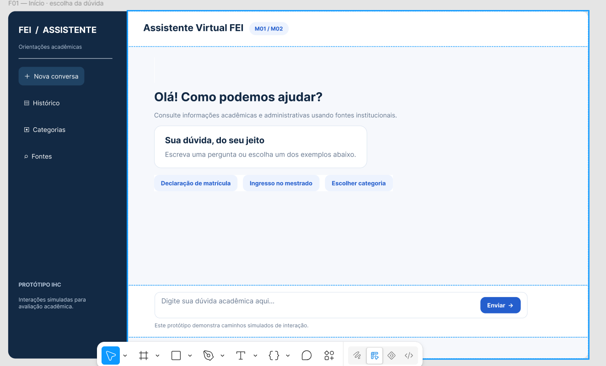
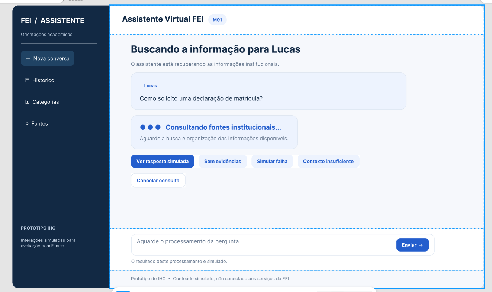
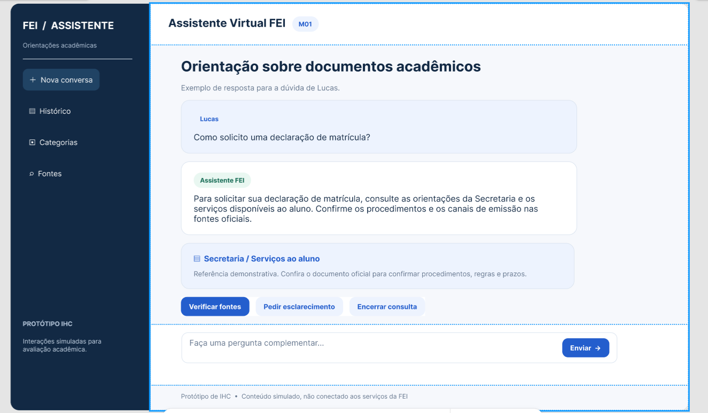
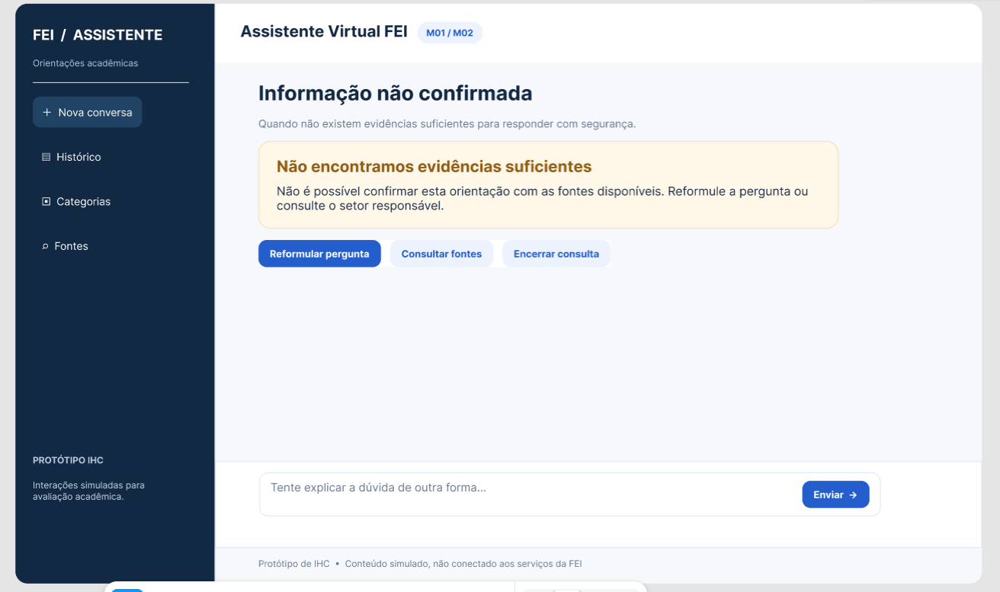
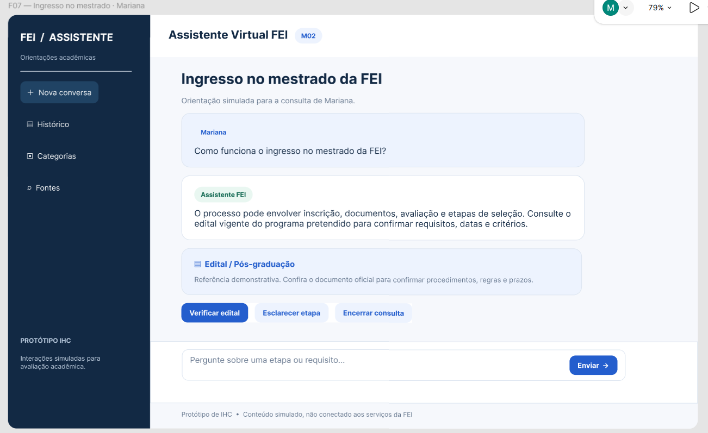
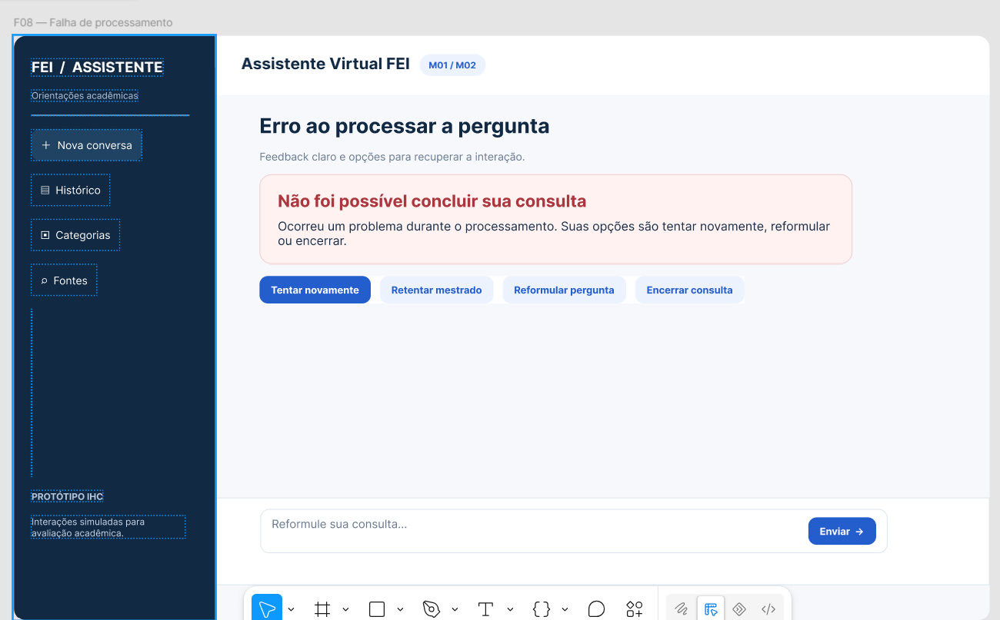
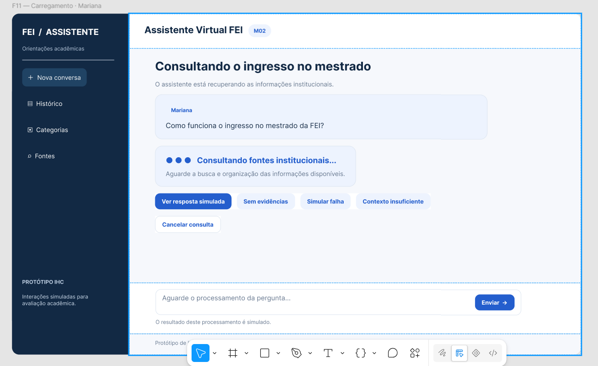
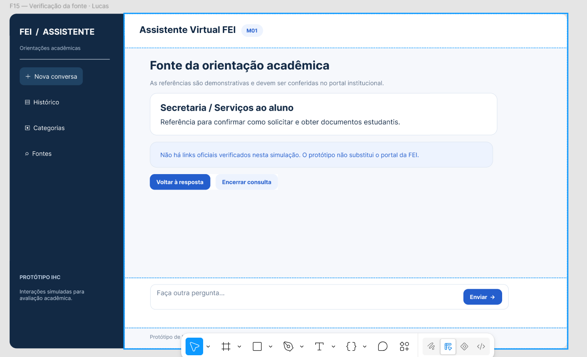
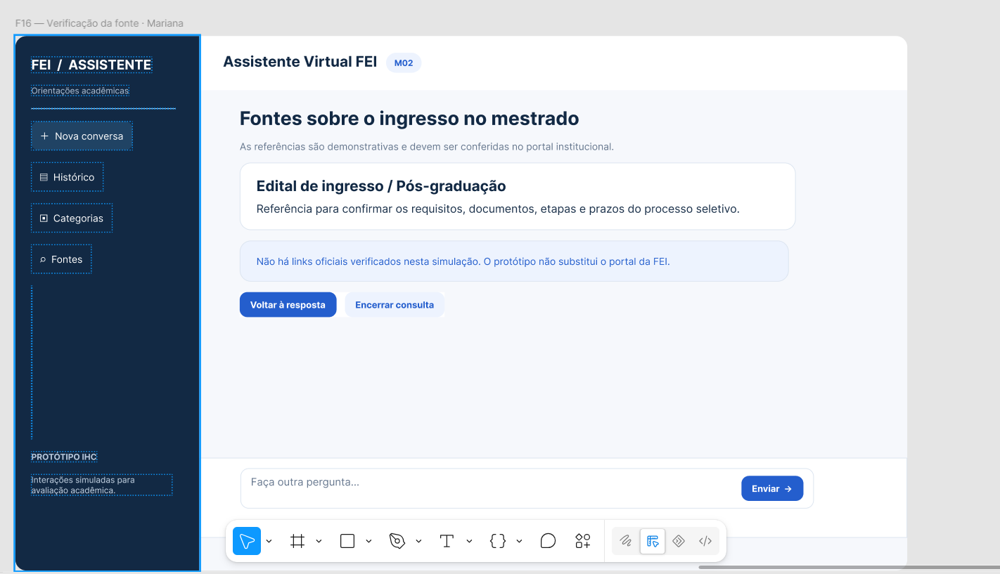

# Entrega 11 — Protótipo no Figma

**Data:** 07/11/2026  
**Status:** 🟩 Concluída  
**Responsabilidade:** 1 protótipo integrado por equipe cobrindo os fluxos MoLIC. Se a turma exigir divisão individual, identifique o responsável por cada fluxo/tela.

## Objetivo da atividade

Materializar o modelo de interação em um protótipo navegável, preservando a lógica dos objetivos, tópicos, signos, feedbacks, alternativas e recuperações definidos anteriormente.

## Biblioteca de possibilidades para projetos técnicos

O protótipo deve materializar os fluxos definidos nas entregas anteriores. Dependendo do escopo, podem fazer sentido:

1. **Dashboard:** indicadores, alertas, estado, tendências e atalhos para tarefas frequentes.
2. **Configuração/parametrização:** escolhas, presets, validação e explicação de opções técnicas.
3. **Entrada de dados:** upload, conexão, seleção, pré-visualização e validação.
4. **Processamento:** fila, status, progresso, cancelamento, falha e reexecução.
5. **Relatório/resultados:** síntese, métricas, gráficos, explicação, exportação e compartilhamento.
6. **Histórico:** busca, filtros, ordenação, paginação, detalhes e repetição de execução.
7. **Comparação:** antes/depois, modelo A/B, execução A/B, baseline ou períodos.
8. **Explicabilidade:** confiança, fatores, evidências, limitações e correção/contestação.
9. **Administração:** usuários, grupos, perfis, permissões, integrações e políticas.
10. **CRUDs de domínio:** somente quando criar/consultar/editar/excluir representa tarefa real.
11. **Auditoria/logs:** histórico de alterações e eventos em linguagem adequada.
12. **Alertas/ocorrências:** severidade, impacto, ação, responsável e resolução.
13. **Ajuda/documentação:** apoio contextual a tarefas complexas.

### Estados que não podem ser esquecidos

Quando aplicável, considere: vazio/sem dados; carregamento/processamento; sucesso; erro de entrada; erro de processamento; filtro sem resultados; permissão insuficiente; confirmação de ação destrutiva; cancelamento/desfazer/recuperação; dados desatualizados/conflito.

> Esta lista é repertório de design, **não uma exigência de quantidade de telas**. A rastreabilidade deve explicar por que cada tela existe.

## Link do Figma

**Protótipo:** https://www.figma.com/design/H0YnqyGWkswU88IUZIgDuW  
**Arquivo editável:** https://www.figma.com/design/H0YnqyGWkswU88IUZIgDuW  
**Última verificação de permissão:** Pendente de teste em janela anônima.

> Teste o link em janela anônima. O avaliador deve conseguir abrir o protótipo sem solicitar permissão.

## Cobertura MoLIC → Figma

| MoLIC | Objetivo | Fluxo/telas no Figma | Estados de erro/recuperação | Responsável |
|---|---|---|---|---|
| M01 | O01 — Consultar e compreender informações acadêmicas ou administrativas da FEI | `F01 → F02 → F03 → F15 → F03 → F14` | `F04` ausência de evidências; `F08` falha de processamento; `F12` esclarecimento acadêmico; `F13` contexto insuficiente; `F14` encerramento | Matheus Dourado Valle |
| M02 | Consultar e compreender informações sobre ingresso no mestrado da FEI | `F01 → F11 → F07 → F16 → F07 → F14` | `F04` ausência de evidências; `F08` falha de processamento; `F09` esclarecimento sobre o mestrado; `F13` contexto insuficiente; `F14` encerramento | João Pedro Sabino Garcia |

As telas F05 (histórico), F06 (categorias) e F10 (fontes gerais) são compartilhadas pelos dois fluxos.

O protótipo representa a interação do estudante com o assistente, não o desempenho técnico do modelo de IA. As perguntas, respostas e fontes são simuladas para permitir a avaliação da interface.

## Catálogo de telas/estados

### F01 — Início e formulação da dúvida

**Objetivo do usuário:** Iniciar uma consulta acadêmica ou administrativa, escolhendo uma pergunta sugerida ou identificando o campo de pergunta.  
**Signos principais:** Nova conversa, pergunta, enviar, histórico, categorias e fontes.  
**Origem no MoLIC:** M01 e M02 — abertura da interação e formulação da pergunta.

### F02 — Processamento da pergunta acadêmica

**Objetivo do usuário:** Compreender que a pergunta de Lucas está sendo processada e identificar as opções de continuidade ou cancelamento.  
**Signos principais:** Pergunta enviada, processamento, consulta às fontes e cancelar consulta.  
**Origem no MoLIC:** M01 — consulta institucional e feedback de processamento.

### F03 — Resposta acadêmica e orientação ao estudante

**Objetivo do usuário:** Compreender a orientação sobre a declaração de matrícula e decidir se deseja verificar as fontes ou solicitar esclarecimentos.  
**Signos principais:** Pergunta, resposta, fonte, verificar fontes, pedir esclarecimento e encerrar consulta.  
**Origem no MoLIC:** M01 — apresentação da resposta, compreensão e continuidade da conversa.

### F04 — Ausência de evidências institucionais

**Objetivo do usuário:** Entender que o assistente não encontrou informações suficientes e escolher entre reformular a pergunta, consultar fontes ou encerrar.  
**Signos principais:** Ausência de evidência, aviso, reformular pergunta e encerrar consulta.  
**Origem no MoLIC:** M01 e M02 — recuperação diante da falta de evidências.

### F07 — Resposta sobre ingresso no mestrado

**Objetivo do usuário:** Compreender uma orientação inicial sobre o ingresso no mestrado e identificar a necessidade de consultar o edital vigente.  
**Signos principais:** Pergunta, resposta, edital, verificar edital, esclarecer etapa e encerrar consulta.  
**Origem no MoLIC:** M02 — apresentação e compreensão da resposta sobre o ingresso no mestrado.

### F08 — Falha de processamento e recuperação

**Objetivo do usuário:** Reconhecer a falha de processamento e escolher entre tentar novamente, reformular a pergunta ou encerrar.  
**Signos principais:** Erro, tentar novamente, reformular pergunta e encerrar consulta.  
**Origem no MoLIC:** M01 e M02 — falha no processamento e recuperação da interação.

### F11 — Processamento da pergunta sobre o mestrado

**Objetivo do usuário:** Identificar que a pergunta de Mariana sobre o mestrado está em processamento e acompanhar as opções disponíveis.  
**Signos principais:** Pergunta enviada, processamento, consulta institucional e cancelar consulta.  
**Origem no MoLIC:** M02 — consulta institucional e feedback de processamento.

### F15 — Verificação da fonte acadêmica

**Objetivo do usuário:** Identificar a referência institucional associada à orientação acadêmica de Lucas e retornar à resposta.  
**Signos principais:** Secretaria, serviços ao aluno, fonte e voltar à resposta.  
**Origem no MoLIC:** M01 — verificação de evidências e retorno à conversa.

### F16 — Verificação da fonte sobre o mestrado

**Objetivo do usuário:** Identificar a referência ao edital de ingresso e retornar à resposta sobre o mestrado.  
**Signos principais:** Edital, pós-graduação, fonte e voltar à resposta.  
**Origem no MoLIC:** M02 — verificação de evidências e retorno à conversa.

**Demais telas presentes no protótipo editável:**

- F05 — Histórico de conversas: permite recuperar consultas simuladas.
- F06 — Categorias: permite selecionar assuntos acadêmicos e administrativos.
- F09 — Esclarecimento do mestrado: permite escolher a etapa da seleção sobre a qual Mariana deseja mais informações.
- F10 — Fontes gerais: apresenta as referências institucionais demonstrativas.
- F12 — Esclarecimento acadêmico: permite que Lucas especifique sua dúvida.
- F13 — Contexto insuficiente: solicita informações adicionais ao estudante.
- F14 — Consulta encerrada: confirma o encerramento e permite iniciar outra conversa.

> Documente também estados que muitas equipes esquecem: carregamento, vazio, confirmação, sucesso, erro, permissão negada, cancelamento, desfazer/voltar quando aplicável.

## Sistema visual e consistência

| Elemento | Regra adotada | Justificativa |
|---|---|---|
| Tipografia | Fonte Inter, com títulos destacados, textos explicativos menores e hierarquia entre perguntas, respostas e ações. | Facilitar a leitura e a identificação das informações mais importantes. |
| Cores | Azul-escuro no menu lateral, azul nos botões principais, branco e cinza-claro nas áreas de conteúdo, amarelo para ausência de evidências, vermelho para falhas e verde para confirmação. | Manter consistência visual e diferenciar os estados da interação. |
| Componentes | Menu lateral padronizado, cartões de mensagens, campo de pergunta, botões de navegação, etiquetas e cartões de fontes. | Permitir que o estudante reconheça os mesmos elementos ao navegar pelas diferentes telas. |
| Feedback | Mensagens de processamento, apresentação da resposta, aviso de ausência de evidências, explicação de erros e confirmação de encerramento. | Informar o estado da consulta e apresentar opções de continuidade ou recuperação. |

## Verificação de acessibilidade básica

Para produto Web, considere critérios pertinentes da WCAG vigente (por exemplo, contraste, foco, tamanho de alvo, texto alternativo e navegação por teclado quando aplicáveis). Para outras plataformas, use as recomendações adequadas ao contexto.

O protótipo utiliza títulos destacados, textos com hierarquia visual, botões identificados por palavras e estados de erro acompanhados de mensagens explicativas.

As cores ajudam a diferenciar os estados, mas as mensagens também descrevem o que está acontecendo, sem depender exclusivamente da cor.

Os cartões foram ajustados para apresentar integralmente os textos de perguntas, respostas e feedbacks.

Como se trata de um protótipo navegável no Figma, a digitação livre, a navegação por teclado, a indicação de foco e os critérios formais de contraste ainda dependem de verificação específica. Não há integração funcional com o backend do TCC.

## Checklist

- [x] Link do Figma está acessível.
- [x] Há screenshots representativos no repositório.
- [x] Todos os MoLIC relevantes estão cobertos.
- [x] Estados de erro, feedback e recuperação foram prototipados.
- [x] Terminologia/signos são consistentes com Entrega 9.
- [x] Componentes equivalentes se comportam de forma consistente.
- [x] Fluxos críticos são clicáveis do início ao fim.
- [x] O protótipo está pronto para inspeção e testes, sem “links mortos” nas tarefas avaliadas.
- [x] Dashboards, relatórios, históricos, filtros, administração e CRUDs presentes possuem justificativa rastreável.
- [x] Estados de vazio, processamento, erro e recuperação foram considerados quando pertinentes.
- [x] Resultados técnicos são apresentados de forma interpretável para o perfil de usuário.
- [x] A equipe distingue no protótipo o que é interação simulada e o que é funcionalidade técnica realmente integrada, quando necessário.
