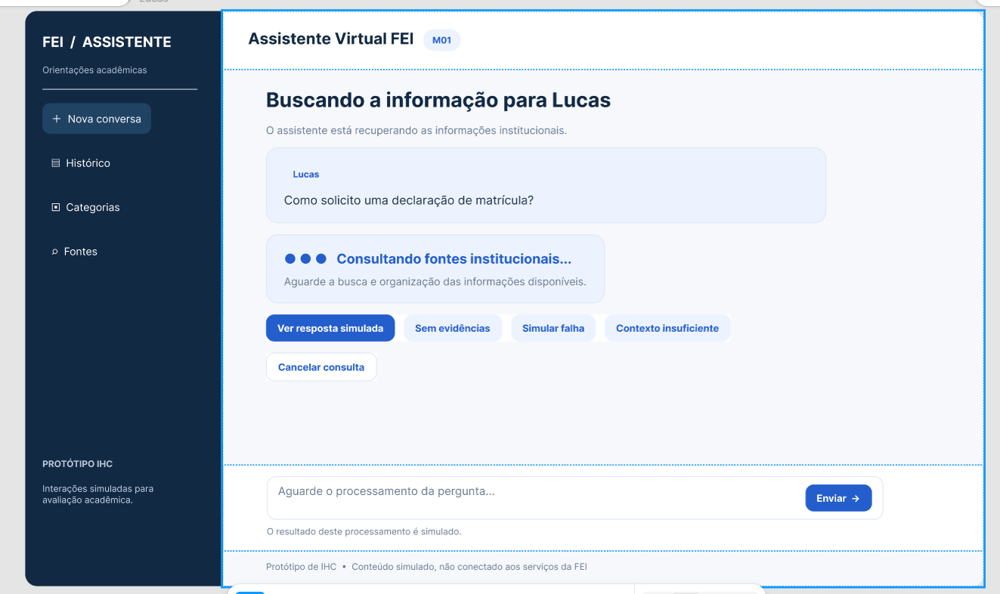
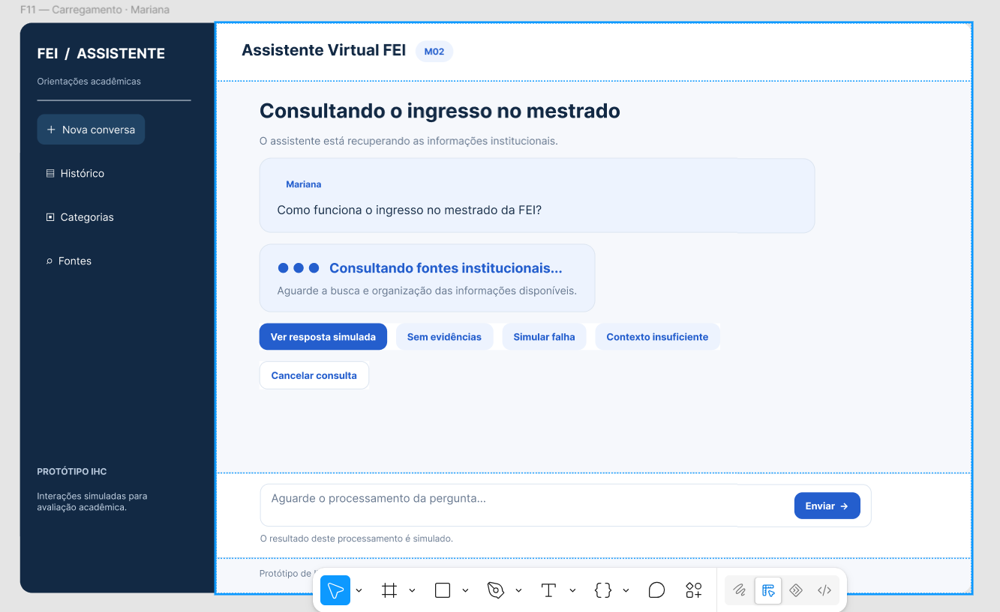
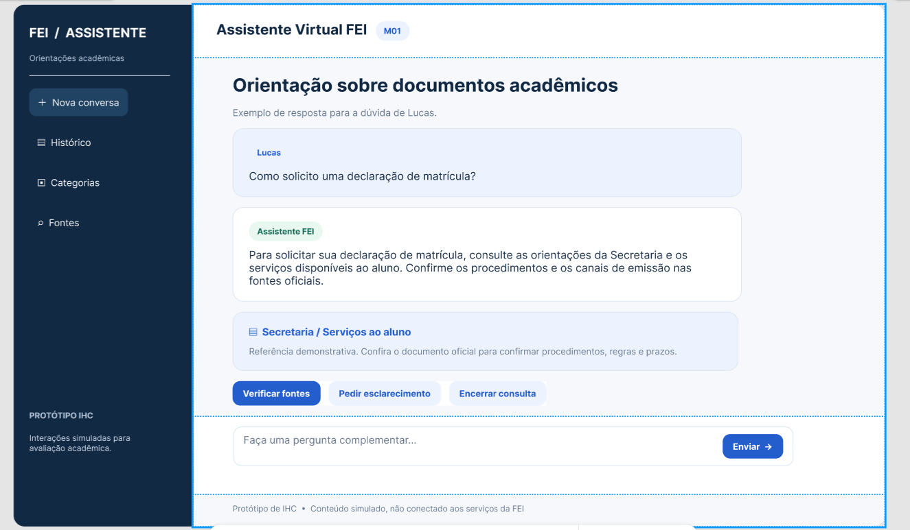
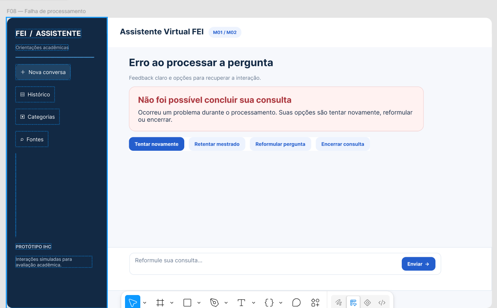

# Entrega 13 — Avaliação de IHC por inspeção heurística

**Data:** 14/11/2026  
**Status:** 🟩 concluída — documentação e consolidação finalizadas  
**Responsabilidade:** 1 avaliação completa por integrante, sobre todas as telas/estados relevantes do projeto.

## Objetivo da atividade

Encontrar problemas de usabilidade por inspeção sistemática da interface com as **10 heurísticas de Nielsen**. Cada avaliador trabalha individualmente primeiro; depois a equipe consolida problemas duplicados e prioridades.

> **Parte de violações:** registre somente problemas reais. Não invente uma violação para “preencher” cada heurística. Para provar que todas foram exercitadas, use a **matriz de cobertura H1–H10**. Para heurísticas sem violação, a disciplina solicita um exemplo didático de boa prática.

## 1. Heurísticas adotadas

1. Visibilidade do status do sistema
2. Compatibilidade entre o sistema e o mundo real
3. Controle e liberdade do usuário
4. Consistência e padrões
5. Prevenção de erros
6. Reconhecimento em vez de memorização
7. Flexibilidade e eficiência de uso
8. Estética e design minimalista
9. Ajudar usuários a reconhecer, diagnosticar e recuperar-se de erros
10. Ajuda e documentação

## Cobertura especial para interfaces administrativas e analíticas

Quando existirem, não limite a avaliação às “telas principais”. Inspecione também:

- dashboard em estados normal, vazio e erro;
- filtros sem resultado e filtros combinados;
- relatórios e exportação;
- histórico/listas longas;
- formulários CRUD (criação, edição, exclusão, validação);
- alteração de perfil/permissão;
- confirmações de ações destrutivas;
- processamento/loading/progresso;
- falha e recuperação;
- comparação de resultados;
- mensagens de termos técnicos, métricas e recomendações;
- ajuda/documentação contextual.

Em TCCs técnicos, observe especialmente se a interface comunica o estado do processamento e traduz informações técnicas para o vocabulário do usuário escolhido.

## 2. Escopo da inspeção

| Item | Definição |
|---|---|
| Versão avaliada | Protótipo no Figma — Assistente Virtual Acadêmico da FEI, em 14/11/2026. |
| Link | https://www.figma.com/design/H0YnqyGWkswU88IUZIgDuW |
| Telas/estados | F01–F16, contemplando início, carregamento, respostas acadêmicas, ausência de evidências, histórico, categorias, falhas, esclarecimentos, contexto insuficiente, encerramento e consulta de fontes. |
| Fluxos | M01 — Matheus e M02 — João. |
| Dispositivo/viewport | Desktop — interface web, com dimensões de 1280 × 768 pixels no Figma. |
| Avaliadores | Matheus Dourado Valle (A01) e João Pedro Sabino Garcia (A02). |

## 3. Procedimento individual

Cada avaliador deve:

1. percorrer os fluxos/telas ao menos uma vez para familiarização;
2. inspecionar novamente aplicando sistematicamente H1–H10;
3. registrar cada problema com evidência e contexto;
4. atribuir severidade **depois de compreender bem o problema**, justificando a decisão;
5. não discutir achados com os demais antes de terminar a inspeção individual, quando o objetivo for preservar independência.

A inspeção do avaliador A01 considerou os principais fluxos e estados do protótipo, observando a facilidade de utilização, clareza das informações, apresentação das fontes, navegação, feedback e recuperação de erros.

A avaliação considera exclusivamente a qualidade da interação e da interface do protótipo, não o desempenho técnico ou a precisão científica dos modelos de inteligência artificial.

### Escala de severidade (0–4)

| Grau | Interpretação |
|---:|---|
| 0 | não é considerado problema de usabilidade |
| 1 | problema cosmético; corrigir se houver tempo |
| 2 | problema menor; baixa prioridade |
| 3 | problema maior; alta prioridade |
| 4 | catástrofe de usabilidade; correção imperativa antes de disponibilizar |

Ao justificar, considere **frequência, impacto e persistência** do problema no contexto real de uso.

---

## Avaliador A01 — Matheus Dourado Valle

### 4. Matriz de cobertura das 10 heurísticas

| Heurística | Telas/fluxos examinados | Houve violação? | IDs dos achados | Exemplo de boa prática se não violada |
|---|---|---|---|---|
| H1 — Visibilidade do status do sistema | F02 e F11 | não | — | As mensagens de carregamento informam que o assistente está consultando fontes institucionais e processando a pergunta. |
| H2 — Compatibilidade entre sistema e mundo real | F02 e F11 | sim | V01 | — |
| H3 — Controle e liberdade do usuário | F04 e F08 | não | — | O usuário possui opções para reformular perguntas, cancelar consultas e tentar novamente. |
| H4 — Consistência e padrões | F01–F16 | não | — | O menu lateral, cabeçalho e estrutura de conversação mantêm uma organização consistente entre as telas. |
| H5 — Prevenção de erros | F01 e F04 | não | — | As sugestões de perguntas e alternativas de consulta ajudam o estudante a formular dúvidas e encontrar caminhos adequados. |
| H6 — Reconhecimento em vez de memorização | F03, F07, F15 e F16 | sim | V02 | — |
| H7 — Flexibilidade e eficiência de uso | F01 e F04 | não | — | O usuário pode iniciar uma consulta por sugestões ou formular sua própria pergunta, além de acessar diferentes alternativas de interação. |
| H8 — Estética e design minimalista | F01 e F04 | não* | — | As telas apresentam mensagens principais e ações relacionadas ao contexto, mantendo o foco na interação. |
| H9 — Ajudar usuários a reconhecer, diagnosticar e recuperar-se de erros | F04 e F08 | não | — | Quando ocorre uma falha ou ausência de evidências, são apresentadas alternativas para continuar a interação. |
| H10 — Ajuda e documentação | F01 | não | — | A tela inicial apresenta orientações para começar a utilizar o assistente e exemplos de dúvidas que podem ser consultadas. |

*Na H8, não foi identificada uma violação na organização do conteúdo observado. Contraste e legibilidade visual não foram avaliados em profundidade.*

### 5. Declaração de violações

| ID | Heurística | Tela/estado | Problema observado | Evidência | Severidade | Justificativa da severidade | Recomendação |
|---|---|---|---|---|---:|---|---|
| V01 | H2 | F02 e F11 | Durante o processamento, são apresentadas opções como "Ver resposta simulada", "Sem evidências" e "Simular falha", que representam controles de demonstração do protótipo e não ações naturais de um estudante utilizando o assistente. | [F02](../assets/11_figma/f02.png) e [F11](../assets/11_figma/f11.png). | 2 | Pode gerar dúvidas sobre a finalidade dos controles e prejudicar a naturalidade da interação, embora não impeça necessariamente a continuidade do fluxo. | Restringir os controles de simulação ao ambiente de avaliação ou substituí-los por ações adequadas ao estudante. |
| V02 | H6 | F03, F07, F15 e F16 | As fontes são apresentadas com identificações genéricas, como "Secretaria / Serviços ao aluno" e "Edital de ingresso / Pós-graduação", sem identificação de documentos específicos ou links oficiais para consulta. | [F03](../assets/11_figma/f03.png), [F07](../assets/11_figma/f07.png), [F15](../assets/11_figma/f15.png) e [F16](../assets/11_figma/f16.png). | 3 | Dificulta a identificação e a verificação das informações utilizadas pelo assistente. Como a consulta às fontes é uma funcionalidade central do projeto, o problema pode comprometer a confiança do estudante nas respostas. | Apresentar o título completo do documento, setor responsável, data ou versão e link direto para a fonte institucional. |

**Qualidade do relato:** os problemas foram identificados em telas e elementos específicos do protótipo, considerando suas consequências para a experiência do estudante.

**Evidências do problema V01**

**Evidências do problema V02**

### 6. Boas práticas — heurísticas não violadas (atividade didática)

| Heurística sem violação | Exemplo no sistema | Evidência | Por que atende |
|---|---|---|---|
| H1 — Visibilidade do status do sistema | F02 e F11 — mensagens de carregamento. | [F02](../assets/11_figma/f02.png) e [F11](../assets/11_figma/f11.png). | O sistema informa que está consultando fontes institucionais e orienta o usuário a aguardar o processamento. |
| H3 — Controle e liberdade do usuário | F04 e F08 — alternativas para reformular perguntas, tentar novamente ou encerrar a consulta. | [F04](../assets/11_figma/f04.png) e [F08](../assets/11_figma/f08.png). | O usuário possui alternativas para modificar o caminho da interação quando necessário. |
| H4 — Consistência e padrões | F01, F02, F03, F04, F07, F08, F11, F15 e F16 — estrutura de navegação e cabeçalho. | [F01](../assets/11_figma/f01.png) e [F03](../assets/11_figma/f03.png). | Os elementos principais de navegação e interação mantêm uma organização semelhante entre as diferentes telas. |
| H5 — Prevenção de erros | F01 — sugestões de perguntas e opções iniciais de consulta. | [F01](../assets/11_figma/f01.png). | As sugestões ajudam o estudante a formular dúvidas e identificar possibilidades de consulta. |
| H7 — Flexibilidade e eficiência de uso | F01 — sugestões iniciais e campo para digitação de perguntas próprias. | [F01](../assets/11_figma/f01.png). | O usuário pode escolher entre utilizar uma sugestão ou formular sua própria pergunta, oferecendo diferentes maneiras de iniciar uma consulta. |
| H8 — Estética e design minimalista | F04 — apresentação da ausência de evidências. | [F04](../assets/11_figma/f04.png). | A tela concentra a informação na mensagem principal e nas alternativas de continuidade, sem apresentar informações funcionais desnecessárias. |
| H9 — Recuperação de erros | F08 — opções para tentar novamente, reformular a pergunta ou encerrar a consulta. | [F08](../assets/11_figma/f08.png). | O usuário recebe orientações e alternativas para recuperar a interação após uma falha de processamento. |
| H10 — Ajuda e documentação | F01 — orientações iniciais e exemplos de perguntas. | [F01](../assets/11_figma/f01.png). | A tela inicial orienta o usuário sobre como começar a utilizar o assistente e apresenta exemplos que facilitam a compreensão de suas possibilidades. |

---

## Avaliador A02 — João Pedro Sabino Garcia

Os achados e as respectivas severidades foram apresentados a João Pedro Sabino Garcia e aceitos por ele, conforme confirmação da equipe. A avaliação a seguir está organizada separadamente da avaliação A01 e considera o fluxo M02 e os estados compartilhados da interface.

### 4. Matriz de cobertura das 10 heurísticas

| Heurística | Telas/fluxos examinados | Houve violação? | IDs dos achados | Exemplo de boa prática se não violada |
|---|---|---|---|---|
| H1 — Visibilidade do status do sistema | F02 e F11 | não | — | Durante o carregamento, as mensagens informam que o sistema está consultando fontes institucionais. |
| H2 — Compatibilidade entre sistema e mundo real | F01 e F07 | não | — | São usados termos acadêmicos conhecidos, como ingresso no mestrado e edital. |
| H3 — Controle e liberdade do usuário | F04 e F08 | não | — | O estudante pode reformular a dúvida, tentar novamente ou encerrar a consulta. |
| H4 — Consistência e padrões | F01–F16, especialmente F08 | sim | A02-V01 | — |
| H5 — Prevenção de erros | F01 e F04 | não | — | A interface fornece exemplos de perguntas e comunica a ausência de evidências, evitando transmitir certeza indevida. |
| H6 — Reconhecimento em vez de memorização | F03, F07, F15 e F16 | sim | A02-V02 | — |
| H7 — Flexibilidade e eficiência de uso | F01 e F07 | não | — | As sugestões permitem iniciar consultas sem precisar formular a dúvida do zero. |
| H8 — Estética e design minimalista | F01 e F04 | não | — | A organização prioriza a informação principal e as ações relacionadas ao contexto. |
| H9 — Ajudar usuários a reconhecer, diagnosticar e recuperar-se de erros | F04 e F08 | não | — | As telas de ausência de evidências e falha apresentam explicações e caminhos de recuperação. |
| H10 — Ajuda e documentação | F01 | não | — | A tela inicial apresenta orientações e exemplos de dúvidas que podem ser feitas. |

### 5. Declaração de violações

| ID | Heurística | Tela/estado | Problema observado | Evidência | Severidade | Justificativa da severidade | Recomendação |
|---|---|---|---|---|---:|---|---|
| A02-V01 | H4 | F08 — Falha de processamento | A tela apresenta os botões “Tentar novamente” e “Retentar mestrado”, sem explicar claramente a diferença entre as ações. A nomenclatura semelhante pode levar o estudante a não reconhecer qual delas retoma a pergunta atual. | [F08](../assets/11_figma/f08.png). | 2 | O problema pode ocorrer a cada falha de processamento. O impacto é moderado porque as ações de recuperação continuam disponíveis, mas a dúvida sobre seu efeito pode persistir até a escolha do estudante. | Diferenciar explicitamente os objetivos das ações, por exemplo, “Repetir esta pergunta” e “Retomar consulta sobre mestrado”; caso produzam o mesmo efeito, manter apenas uma delas. |
| A02-V02 | H6 | F07 e F16 — Resposta e verificação da fonte do mestrado | A referência ao edital de ingresso é genérica e não apresenta identificação documental completa nem acesso direto a uma fonte oficial verificada. O estudante precisa procurar o documento por conta própria. | [F07](../assets/11_figma/f07.png) e [F16](../assets/11_figma/f16.png). | 3 | O problema é observado tanto na resposta quanto na tentativa de verificação da fonte e permanece enquanto não há uma referência específica. Pode dificultar a confirmação de documentos, requisitos e prazos, afetando uma atividade central da consulta. | Apresentar o nome completo do edital, setor responsável, data ou versão e link oficial quando disponível, distinguindo claramente uma referência demonstrativa de uma fonte efetivamente verificada. |

**Qualidade do relato:** os achados estão associados a telas, elementos, consequências e recomendações específicas. As evidências reutilizam as imagens já produzidas para a Entrega 11, sem necessidade de novas capturas.

**Evidências do problema A02-V01**

**Evidências do problema A02-V02**

### 6. Boas práticas — heurísticas não violadas (atividade didática)

| Heurística sem violação | Exemplo no sistema | Evidência | Por que atende |
|---|---|---|---|
| H1 — Visibilidade do status do sistema | F11 — mensagem de carregamento da consulta. | [F11](../assets/11_figma/f11.png). | Informa que o assistente está consultando informações institucionais durante o processamento. |
| H2 — Compatibilidade entre sistema e mundo real | F07 — consulta sobre ingresso no mestrado. | [F07](../assets/11_figma/f07.png). | Utiliza vocabulário correspondente ao processo acadêmico que o estudante deseja compreender. |
| H3 — Controle e liberdade do usuário | F04 e F08 — opções de recuperação e encerramento. | [F04](../assets/11_figma/f04.png) e [F08](../assets/11_figma/f08.png). | Permite reformular, tentar novamente ou encerrar a consulta, sem obrigar o estudante a permanecer no estado de erro. |
| H5 — Prevenção de erros | F04 — aviso de ausência de evidências suficientes. | [F04](../assets/11_figma/f04.png). | Evita que uma orientação sem suporte seja apresentada como resposta confirmada. |
| H7 — Flexibilidade e eficiência de uso | F01 — exemplos de perguntas e campo de texto. | [F01](../assets/11_figma/f01.png). | Oferece opções prontas e entrada livre, atendendo a diferentes formas de iniciar a consulta. |
| H8 — Estética e design minimalista | F04 — mensagem central de ausência de evidências. | [F04](../assets/11_figma/f04.png). | Apresenta a mensagem principal e as próximas ações sem excesso de informações no conteúdo observado. |
| H9 — Recuperação de erros | F08 — mensagem de falha e ações para continuar. | [F08](../assets/11_figma/f08.png). | Explica que houve problema no processamento e oferece alternativas de continuidade. |
| H10 — Ajuda e documentação | F01 — orientações iniciais e perguntas sugeridas. | [F01](../assets/11_figma/f01.png). | Demonstra como começar a interação e que tipos de dúvidas podem ser apresentados. |

## 7. Consolidação da equipe

Problemas iguais ou muito semelhantes encontrados por avaliadores diferentes devem ser consolidados, preservando quem os encontrou.

Os achados de A01 e A02 foram comparados. A deficiência na identificação de fontes aparece nos dois registros individuais, V02(A01) e A02-V02(A02), e foi agrupada em um único problema consolidado. A ambiguidade dos botões na tela de falha foi mantida como problema distinto.

| ID consolidado | Achados individuais | Heurística | Problema | Severidade final | Prioridade | Responsável pela correção |
|---|---|---|---|---:|---|---|
| HC01 | V02(A01), A02-V02(A02) | H6 | Fontes institucionais apresentadas sem identificação documental específica ou link verificável nas respostas e telas de consulta às fontes. | 3 | alta | Matheus e João |
| HC02 | A02-V01(A02) | H4 | Ações “Tentar novamente” e “Retentar mestrado” aparecem juntas na tela F08 sem diferenciação suficientemente clara. | 2 | baixa | Matheus e João |

**Observação sobre V01(A01):** o texto original da avaliação de Matheus foi preservado integralmente. Posteriormente, foi esclarecido que os botões de simulação das telas F02 e F11 são exclusivos da demonstração dos estados do protótipo. Assim, V01(A01) foi **desconsiderado na consolidação**, pois não representa um problema da interface destinada ao estudante. O registro permanece na seção individual apenas para preservar o texto original e a rastreabilidade da revisão.

**Resultado da consolidação:** três registros individuais válidos (um de A01 e dois de A02) correspondem a **dois problemas únicos**, sendo um de severidade 3 e outro de severidade 2. Não foram identificadas violações de severidade 4.

## 8. Síntese e plano de melhoria

- Quantidade de problemas por heurística e severidade.
- Problemas críticos/graves que bloqueiam teste ou release.
- Padrões recorrentes entre telas.
- Correções que serão feitas antes/para a avaliação com usuários.

**Quantidade de problemas por heurística e severidade**

| Heurística | Achados válidos A01 | Achados A02 | Problemas consolidados | Severidade final |
|---|---:|---:|---:|---|
| H4 — Consistência e padrões | 0 | 1 | 1 (HC02) | 2 |
| H6 — Reconhecimento em vez de memorização | 1 | 1 | 1 (HC01) | 3 |
| Demais heurísticas | 0 | 0 | 0 | — |
| **Total** | **1** | **2** | **2** | **Um grau 2 e um grau 3** |

O registro V01(A01) não é contabilizado, conforme a justificativa apresentada na seção 7. Não foi necessário criar violações para as demais heurísticas, pois elas estão documentadas nas matrizes de cobertura e nas tabelas de boas práticas.

**Problemas críticos/graves que bloqueiam teste ou release**

Não foram identificados problemas de severidade 4 nem evidência de bloqueio absoluto dos fluxos de interação. O achado **HC01 (severidade 3)**, relativo à identificação das fontes, requer prioridade alta antes de disponibilizar o assistente como canal de consulta acadêmica efetiva, pois compromete a verificação das informações pelo estudante. O achado **HC02 (severidade 2)** não impede a continuidade do fluxo, mas pode causar dúvidas na recuperação de uma falha.

**Padrões recorrentes entre telas**

- Identificação insuficiente das fontes em diferentes estados de resposta e verificação: F03, F07, F15 e F16, afetando os fluxos M01 e M02.
- Ações com nomes semelhantes na tela F08, dificultando reconhecer o efeito de cada tentativa de recuperação.
- Mensagens de carregamento e ausência de evidências representam boas práticas de feedback; os controles exclusivos de demonstração não foram contabilizados como problemas da interface do estudante.

**Correções que serão feitas antes/para a avaliação com usuários**

| Prioridade | Achado | Correção proposta | Responsáveis | Situação |
|---|---|---|---|---|
| Alta | HC01 | Exibir referência institucional específica, com título do documento, setor responsável, versão ou data e link oficial quando disponível. | Matheus e João | Planejada |
| Baixa | HC02 | Renomear os controles de nova tentativa para explicar sua finalidade ou unificá-los quando tiverem a mesma função. | Matheus e João | Planejada |

A inspeção heurística está documentada e os achados foram consolidados. As correções acima são propostas de melhoria e **não são apresentadas como alterações já implementadas no protótipo**.

## Checklist

- [x] Cada integrante fez uma inspeção completa e identificada. 
- [x] Todas as telas/estados relevantes foram contemplados no escopo e nas matrizes.
- [x] Estados administrativos, filtros, relatórios, históricos, processamento e erros foram incluídos quando existentes; foram considerados os estados pertinentes ao chatbot.
- [x] A inspeção avaliou a interface/protótipo, não o mérito técnico do algoritmo/modelo.
- [x] H1–H10 aparecem na matriz de cobertura de cada avaliador.
- [x] Parte de violações contém apenas violações, sem “forçar” exemplos.
- [x] Todo problema consolidado tem print/localização e contexto.
- [x] Severidade possui justificativa, não apenas número.
- [x] Recomendação resolve a causa ou reduz o impacto.
- [x] Achados duplicados foram consolidados ao final.
