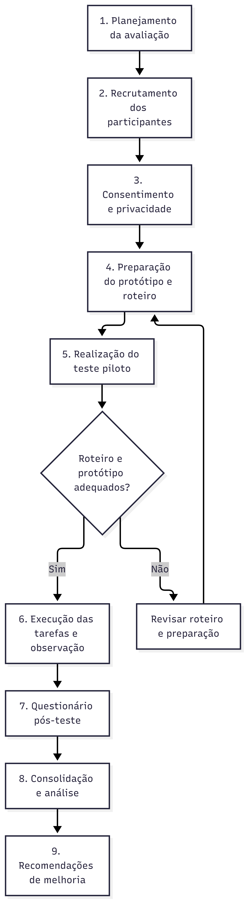

# Entrega 14 — Avaliação de usabilidade por observação de usuários

**Data:** 14/11/2026  
**Status:** 🟩 concluída — testes com os dois participantes, consolidação e análise finalizadas  
**Responsabilidade:** solução consolidada por equipe. O número de participantes finais observados deve ser igual ao número de integrantes, conforme o modelo da disciplina; recomenda-se que cada integrante seja responsável por conduzir/analisar ao menos um participante.

## Objetivo da atividade

Observar usuários representativos realizando tarefas reais ou realisticamente simuladas para identificar problemas de eficácia, eficiência, compreensão e satisfação que não podem ser inferidos apenas por inspeção.

> **Participantes finais não devem ser membros da equipe.** Um integrante pode participar do teste piloto apenas para validar roteiro/equipamentos, sem contar na amostra final.

### Quando o usuário é um perfil profissional especializado

Em TCCs técnicos, o público pode ser DBA, analista, pesquisador, administrador, técnico ou outro especialista. Priorize participantes que possuam relação real com as tarefas. Se não for possível recrutar o perfil ideal, qualquer participante aproximado/proxy deve ser **justificado previamente e tratado como limitação**; não apresente o resultado como equivalente ao de especialistas reais.

O teste avalia a **interação com o protótipo**. Não é necessário que o participante valide o desempenho científico do algoritmo. Resultados simulados podem ser usados quando declarados e coerentes com a tarefa.

Tarefas podem envolver, por exemplo, interpretar um dashboard, configurar uma análise, encontrar uma execução no histórico usando filtros, comparar resultados, gerar relatório, revisar alerta ou administrar permissões.

## A. Fluxograma do processo — equipe

O fluxograma deve representar, no mínimo: planejamento → recrutamento → consentimento → preparação → execução das tarefas/observação → pós-teste → consolidação/análise → recomendações.

## B. Procedimento de preparação e execução — equipe

### Passo 1 — Objetivos e versão avaliada

**Versão/commit/Figma:** [Assistente Virtual Acadêmico da FEI](https://www.figma.com/design/H0YnqyGWkswU88IUZIgDuW)

**Metas de usabilidade relacionadas:**

- MU01 — Compreensão: verificar se os estudantes compreenderam as funcionalidades da interface, as respostas apresentadas e as fontes institucionais.
- MU02 — Eficácia: avaliar se os participantes conseguiram concluir as tarefas propostas.
- MU03 — Eficiência: analisar o tempo necessário para realizar as tarefas e a quantidade de erros e pedidos de ajuda.
- MU04 — Satisfação: verificar a percepção dos participantes em relação à facilidade de utilização do protótipo.
- MU05 — Erros e recuperação: avaliar se os participantes conseguiram compreender mensagens de erro e identificar alternativas para continuar suas consultas.

### Passo 2 — Participantes

| ID | Perfil | Critérios que justificam participação | Integrante responsável |
|---|---|---|---|
| U01 | Estudante da FEI, familiarizado com plataformas acadêmicas e ferramentas de inteligência artificial. | Selecionado por pertencer diretamente ao público-alvo do Assistente Virtual Acadêmico da FEI. Sua experiência com sistemas acadêmicos e ferramentas digitais permitiu observar a compreensão das respostas, a navegação e a facilidade de utilização do protótipo. | Matheus Dourado Valle — 22.224.023-6 |
| U02 | Estudante da FEI. | Selecionado por pertencer diretamente ao público-alvo do assistente. Sua participação permitiu avaliar as consultas institucionais, o acesso ao histórico e a continuidade da interação após respostas inconclusivas. | João Pedro Sabino Garcia — 22.224.032-7 |

Os dois participantes são estudantes da FEI e não integram a equipe responsável pelo desenvolvimento do protótipo. Portanto, não foi necessário utilizar participantes aproximados (*proxy*).

### Passo 3 — Consentimento e privacidade

- Termo/registro de consentimento: os participantes U01 e U02 autorizaram sua participação e a utilização dos resultados para fins acadêmicos. O consentimento foi registrado por meio de mensagens privadas e os comprovantes foram mantidos pela equipe, sem publicação no repositório.
- Gravação de tela/áudio/vídeo: não foi realizada gravação. As sessões foram documentadas por meio de anotações dos moderadores, registrando conclusão das tarefas, dificuldades, tempos, erros, pedidos de ajuda e satisfação. Conforme o procedimento adotado pela equipe, a gravação não foi exigida para esta entrega.
- Forma de anonimização: os participantes foram identificados pelos códigos `U01` e `U02`, preservando suas identidades nas tabelas de avaliação.
- Local e período de armazenamento: os registros foram mantidos em ambiente privado da equipe, com acesso restrito aos integrantes, durante o período necessário à conclusão da avaliação acadêmica.

### Passo 4 — Teste piloto

**Data:** 14/11/2026

**Participante piloto:** Matheus Dourado Valle — 22.224.023-6.

**Moderador:** João Pedro Sabino Garcia — 22.224.032-7.

**Objetivo:** Verificar a clareza das instruções, o funcionamento do protótipo no Figma, a adequação das tarefas propostas e o procedimento de registro das observações antes da avaliação com os participantes finais.

**O que foi validado:** O teste piloto permitiu verificar os seguintes aspectos:

- Clareza das instruções das tarefas UT01, UT02, UT03 e UT04.
- Disponibilidade das telas necessárias no protótipo.
- Funcionamento dos elementos de navegação.
- Adequação da sequência das tarefas.
- Tempo necessário para realizar as atividades.
- Possibilidade de registrar tempos, erros e pedidos de ajuda.
- Clareza das perguntas utilizadas no pós-teste.

**Resultados do teste piloto:**

| Tarefa | Resultado | Tempo | Dificuldades identificadas | Ajustes realizados |
|---|---|---|---|---|
| UT01 — Rematrícula | Concluída | 00:55 | Não foram identificadas dificuldades relevantes. | A instrução original foi mantida. |
| UT02 — Documentos acadêmicos | Concluída | 01:20 | Foi identificada a necessidade de deixar mais claro que o participante deveria verificar a origem da informação. | A instrução foi ajustada para solicitar a identificação da fonte institucional, sem indicar onde encontrá-la. |
| UT03 — Histórico | Concluída | 00:40 | Não foram identificadas dificuldades relevantes. | A instrução original foi mantida. |
| UT04 — Resposta inconclusiva | Concluída | 01:30 | Foi identificada a necessidade de esclarecer que o participante deveria tentar continuar a consulta. | O cenário foi ajustado para solicitar uma alternativa de continuidade, sem ensinar o caminho. |

**Mudanças após piloto:**

1. Na UT02, a instrução foi ajustada para deixar explícita a necessidade de verificar a origem da informação apresentada.
2. Na UT04, o enunciado foi ajustado para esclarecer que o participante deveria identificar uma alternativa para continuar a consulta.
3. A ordem das quatro tarefas foi mantida.
4. Foi mantida a escala de satisfação de 1 a 5 para todas as tarefas.
5. O registro de erros e pedidos de ajuda foi organizado separadamente, facilitando a análise posterior.

O teste piloto permitiu verificar o funcionamento do procedimento de avaliação e identificar pequenos ajustes necessários nas instruções.

As alterações realizadas tiveram como objetivo melhorar a clareza dos cenários apresentados, sem fornecer orientações sobre os caminhos que deveriam ser utilizados pelos participantes.

Após os ajustes, o roteiro foi considerado adequado para a aplicação com os participantes finais U01 e U02.

O participante utilizado no teste piloto não foi contabilizado na amostra final da avaliação.

### Passo 5 — Tarefas

| ID | Cenário/instrução apresentada | Critério de sucesso | Métricas | Ligação com modelo |
|---|---|---|---|---|
| UT01 | "Você precisa descobrir como funciona o processo de rematrícula na FEI. Utilize o assistente virtual para encontrar essa informação." | Realizar a consulta e compreender as informações apresentadas pelo assistente. | Sucesso, tempo, erros, ajudas e satisfação. | T01 / M01 — Consulta de informações acadêmicas. |
| UT02 | "Você precisa descobrir como solicitar uma declaração de matrícula. Utilize o assistente para encontrar essa informação e verificar sua origem." | Consultar a informação e identificar a fonte institucional apresentada na resposta. | Sucesso, tempo, erros, ajudas e satisfação. | T01 / M01 — Consulta e compreensão de informações acadêmicas. |
| UT03 | "Imagine que você realizou uma consulta anteriormente e deseja acessar novamente aquela conversa. Encontre uma conversa anterior." | Localizar e acessar uma conversa disponível no histórico. | Sucesso, tempo, erros, ajudas e satisfação. | M01 — Recuperação de informações e histórico de conversas. |
| UT04 | "Você realizou uma pergunta, mas o assistente informou que não encontrou informações suficientes. Identifique o que aconteceu e tente descobrir como continuar sua consulta." | Compreender a ausência de informações e identificar uma alternativa para continuar a consulta. | Sucesso, tempo, erros, ajudas e satisfação. | M01 — Tratamento de respostas inconclusivas e recuperação de erros. |

### Passo 6 — Protocolo do moderador

1. Receber participante e explicar que **o produto está sendo avaliado, não a pessoa**.
2. Obter consentimento.
3. Aplicar perfil pré-teste mínimo necessário.
4. Ler instruções padronizadas.
5. Observar sem ensinar o caminho; registrar pedidos de ajuda separadamente.
6. Se usar *think aloud*, explicar e aplicar de forma consistente.
7. Após cada tarefa, registrar satisfação/SEQ ou escala definida.
8. Fazer pós-teste/entrevista breve.
9. Encerrar e explicar uso dos dados.

Na avaliação de U02, o moderador apresentou uma explicação básica sobre a finalidade e o funcionamento geral do sistema antes da realização das tarefas.

Durante a execução, João Pedro Sabino Garcia esclareceu dúvidas do participante, mas não indicou os caminhos da interface nem ensinou quais controles deveriam ser utilizados para concluir as atividades.

Os pedidos de ajuda foram registrados separadamente, permitindo analisar a necessidade de esclarecimentos sem confundir esse indicador com falhas completas das tarefas.

## C. Resultados — por participante

### U01 — Estudante da FEI

**Integrante responsável:** Matheus Dourado Valle — 22.224.023-6  
**Protótipo avaliado:** Assistente Virtual Acadêmico da FEI — Figma.  
**Data:** 14/11/2026  
**Escala de satisfação:** 1 (muito insatisfeito) a 5 (muito satisfeito).

| Tarefa | Grau de sucesso | Erros | Tipos de erro/dificuldade | Ajudas | Tempo | Satisfação | Evidência/observação |
|---|---|---:|---|---:|---|---|---|
| UT01 | Total | 0 | Não apresentou dificuldades relevantes. | 0 | 01:12 | 5/5 | O participante identificou rapidamente o campo de mensagens, realizou uma consulta sobre rematrícula e compreendeu a resposta apresentada. |
| UT02 | Total | 1 | Apresentou dificuldade inicial para identificar as fontes institucionais utilizadas na resposta. | 0 | 01:45 | 4/5 | O participante consultou informações sobre documentos acadêmicos, mas demorou para localizar a referência institucional apresentada. Após examinar a resposta, conseguiu identificar a fonte. |
| UT03 | Total | 0 | Não apresentou dificuldades relevantes. | 0 | 00:48 | 5/5 | O participante identificou o histórico na barra lateral e localizou uma conversa anterior sem solicitar auxílio. |
| UT04 | Parcial | 1 | Apresentou dificuldade para identificar como continuar a consulta após uma resposta sem informações suficientes. | 1 | 02:10 | 3/5 | O participante compreendeu que o assistente não possuía informações suficientes, mas necessitou de esclarecimento para identificar como continuar a consulta. |

**Link da gravação (se autorizado):** Não disponível. O registro foi realizado por meio de anotações da avaliação.

**Resposta pós-teste:**

O participante considerou a interface simples, organizada e fácil de utilizar. Destacou que a semelhança com outras ferramentas de inteligência artificial facilitou a compreensão das funcionalidades e permitiu que ele utilizasse o sistema sem dificuldades iniciais.

Em relação às consultas acadêmicas, relatou que conseguiu formular perguntas e compreender as informações apresentadas pelo assistente. Também considerou o histórico de conversas fácil de localizar e utilizar.

Entretanto, apontou que as fontes institucionais poderiam apresentar maior destaque visual, pois demorou um pouco para identificar de onde as informações haviam sido obtidas.

Outra dificuldade mencionada esteve relacionada às situações em que o assistente não conseguiu apresentar uma resposta conclusiva. O participante compreendeu que não havia informações suficientes, mas considerou que a interface poderia oferecer orientações mais claras sobre como continuar.

Como sugestões de melhoria, destacou a necessidade de tornar as fontes mais visíveis e apresentar alternativas de perguntas ou orientações quando o assistente não conseguir responder.

De maneira geral, avaliou positivamente o protótipo e considerou que a ferramenta poderia facilitar a consulta de informações acadêmicas e administrativas da FEI.

### U02 — Estudante da FEI

**Integrante responsável:** João Pedro Sabino Garcia — 22.224.032-7  
**Protótipo avaliado:** Assistente Virtual Acadêmico da FEI — Figma.  
**Data:** 22/11/2026  
**Escala de satisfação:** 1 (muito insatisfeito) a 5 (muito satisfeito).

**Procedimento realizado:**

O participante recebeu uma explicação básica sobre o sistema antes de iniciar a avaliação.

Durante as tarefas, o moderador esclareceu dúvidas sem indicar os caminhos da interface, permitindo que o participante realizasse as ações necessárias.

O moderador registrou a conclusão das atividades, os erros, os pedidos de ajuda, os tempos aproximados e as avaliações de satisfação.

Os tempos foram informados como aproximadamente um minuto por tarefa, não correspondendo a medições com precisão de segundos.

| Tarefa | Grau de sucesso | Erros | Tipos de erro/dificuldade | Ajudas | Tempo | Satisfação | Evidência/observação |
|---|---|---:|---|---:|---|---|---|
| UT01 | Total | 2 | Pequena dificuldade inicial para compreender a utilização do sistema e os passos da tarefa. | 2 | ≈ 01:00 | 5/5 | O participante concluiu a consulta sobre rematrícula. Apesar de dois erros e dois pedidos de esclarecimento, relatou dificuldade muito baixa, concentrada no início da interação. |
| UT02 | Total | 1 | Pequena dificuldade inicial para compreender os passos da consulta. | 1 | ≈ 01:00 | 5/5 | O participante realizou a consulta sobre declaração de matrícula e identificou a fonte institucional. Registrou-se um erro e um pedido de esclarecimento. |
| UT03 | Total | 0 | Nenhuma dificuldade identificada. | 0 | ≈ 01:00 | 5/5 | O participante localizou uma conversa no histórico sem cometer erros ou solicitar ajuda, demonstrando compreensão da funcionalidade. |
| UT04 | Total | 2 | Pequena dificuldade inicial para compreender como continuar a consulta após uma resposta inconclusiva. | 2 | ≈ 01:00 | 5/5 | O participante concluiu a tarefa, embora tenham sido registrados dois erros e dois pedidos de esclarecimento. Relatou dificuldade muito baixa após compreender os passos. |

**Link da gravação (se autorizado):** Não disponível. O teste foi documentado por anotações do moderador.

**Resposta pós-teste:**

O participante considerou o Assistente Virtual Acadêmico da FEI fácil de manusear e demonstrou compreender as funcionalidades propostas.

Relatou que conseguiu entender o funcionamento geral do chatbot e não sentiu dificuldades significativas durante sua utilização.

Apesar de pequenas dúvidas iniciais em algumas tarefas, conseguiu concluir todas as atividades propostas e avaliou sua experiência de maneira positiva.

O participante também afirmou ter gostado bastante do sistema.

**Observação específica sobre a tela F08:**

O participante U02 não interagiu com a tela de falha de processamento F08. Portanto, não foi possível verificar diretamente com ele a compreensão dos botões "Tentar novamente" e "Retentar mestrado", identificados na avaliação heurística como HC02.

## D. Consolidação por tarefa

Para calcular a taxa de sucesso total, considerou-se a proporção de participantes que concluíram integralmente cada tarefa. As conclusões parciais foram registradas separadamente.

Como os tempos de U02 foram informados de forma aproximada, os tempos médios apresentados nesta consolidação também são aproximados.

| Tarefa | Taxa de sucesso | Tempo típico | Erros recorrentes | Satisfação | Meta atendida? | Problemas prioritários |
|---|---:|---|---|---|---|---|
| UT01 | 100% (2/2) | ≈ 01:06 | U01: 0 erro; U02: 2 erros. Não houve recorrência confirmada de um mesmo erro. | 5,0/5 | Eficácia atendida; autonomia apresentou limitações em U02. | Melhorar a compreensão inicial das ações disponíveis. |
| UT02 | 100% (2/2) | ≈ 01:23 | U01: 1 erro; U02: 1 erro. As causas não foram documentadas como idênticas. | 4,5/5 | Eficácia atendida; identificação das fontes merece melhoria. | Fontes institucionais e clareza da consulta. |
| UT03 | 100% (2/2) | ≈ 00:54 | Nenhum erro registrado pelos dois participantes. | 5,0/5 | Sim. | Nenhum problema prioritário identificado. |
| UT04 | 50% (1/2); 1 parcial | ≈ 01:35 | U01: 1 erro; U02: 2 erros. Ambos apresentaram dificuldades, sem confirmação de causas idênticas. | 4,0/5 | Parcialmente; U01 não concluiu integralmente. | Recuperação de respostas inconclusivas e clareza das próximas ações. |

**Consolidação quantitativa:**

| Indicador | U01 | U02 | Consolidado |
|---|---:|---:|---:|
| Tarefas realizadas | 4 | 4 | 8 |
| Conclusões totais | 3 | 4 | 7 |
| Conclusões parciais | 1 | 0 | 1 |
| Falhas completas | 0 | 0 | 0 |
| Taxa de conclusão total | 75% | 100% | 87,5% |
| Erros registrados | 2 | 5 | 7 |
| Pedidos de ajuda | 1 | 5 | 6 |
| Tempo total | 05:55 | ≈ 04:00 | ≈ 09:55 |
| Tempo médio por tarefa | ≈ 01:29 | ≈ 01:00 | ≈ 01:14 |
| Satisfação média | 4,25/5 | 5,00/5 | 4,63/5 |

A satisfação média consolidada corresponde à média das oito notas individuais das tarefas, arredondada para duas casas decimais.

**Análise dos resultados:**

Os dois participantes conseguiram realizar todas as tarefas ao menos parcialmente, com sete conclusões totais e uma parcial.

A tarefa UT03 apresentou o melhor resultado geral: ambos os participantes concluíram a atividade sem erros ou pedidos de ajuda, atribuindo satisfação 5/5.

A tarefa UT02 foi concluída pelos dois participantes, mas ambos registraram um erro. Em U01, esse erro esteve relacionado à dificuldade para identificar a fonte institucional. Em U02, foi relatada pequena dificuldade inicial, sem descrição suficiente para afirmar que ocorreu o mesmo problema.

Na UT04, U01 concluiu a tarefa parcialmente e necessitou de esclarecimento para identificar como continuar a consulta. U02 concluiu totalmente, embora tenha registrado dois erros e dois pedidos de esclarecimento.

A comparação mostrou que a eficácia geral foi positiva, mas a conclusão das tarefas nem sempre ocorreu de maneira totalmente autônoma.

Outro resultado relevante foi a satisfação elevada de U02, mesmo nas tarefas em que ocorreram erros e pedidos de ajuda. Isso indica que a percepção subjetiva positiva não elimina a necessidade de investigar dificuldades observáveis durante a interação.

## E. Achados e recomendações

| ID | Achado | Evidência (quant. + qual.) | Impacto | Recomendação | Artefatos a revisar |
|---|---|---|---|---|---|
| AU01 | Dificuldade para identificar as fontes institucionais apresentadas nas respostas. | U01, UT02: 1 erro, tempo de 01:45 e satisfação de 4/5. O participante apresentou dificuldade para localizar a referência institucional. Na Entrega 13, o problema foi identificado pelos avaliadores A01 e A02 e consolidado como HC01 (H6, severidade 3). U02 concluiu UT02, com 1 erro e 1 ajuda, mas não foi confirmado que esses registros tiveram a mesma causa. | Alto | Apresentar título completo do documento, setor responsável, data ou versão e link institucional verificável. | Protótipo Figma (F03, F07, F15 e F16), modelo conceitual, signos e MoLIC. |
| AU02 | Dificuldade para compreender as alternativas de continuidade após respostas inconclusivas. | U01, UT04: conclusão parcial, 1 erro, 1 ajuda, 02:10 e satisfação 3/5. U02 concluiu UT04, mas registrou 2 erros, 2 ajudas e dificuldade inicial muito baixa. As descrições não permitem afirmar que os erros dos dois participantes tiveram exatamente a mesma causa. | Alto | Destacar alternativas de continuidade, apresentar sugestões claras de reformulação e orientar o estudante sobre os setores institucionais responsáveis quando necessário. | Protótipo Figma (F04 e estados relacionados), MoLIC e fluxos de recuperação. |
| AU03 | Necessidade de esclarecimentos durante algumas tarefas, apesar da satisfação elevada. | U02 concluiu as quatro tarefas, mas registrou 5 erros e 5 pedidos de esclarecimento, distribuídos entre UT01, UT02 e UT04. A satisfação foi 5/5 em todas. O participante relatou pequenas dificuldades iniciais e avaliação geral positiva. | Médio | Revisar a clareza das orientações iniciais, dos rótulos e das ações disponibilizadas nas etapas que exigiram esclarecimentos, verificando se os objetivos podem ser alcançados com maior autonomia. | Protótipo Figma, especialmente F01 e estados relacionados às tarefas UT01, UT02 e UT04. |

Os achados AU01 e AU02 foram mantidos como prioridades em razão das dificuldades observadas e da importância das funcionalidades para o assistente acadêmico.

O achado AU03 destaca a diferença entre a satisfação declarada e a autonomia observada. A necessidade de esclarecimentos não significa necessariamente que o participante considerou a experiência ruim, mas sinaliza oportunidades de aperfeiçoamento.

## F. Comparação com a avaliação heurística

| Problema | Detectado na heurística? | Detectado por usuários? | O que aprendemos |
|---|---|---|---|
| Identificação insuficiente das fontes institucionais nas respostas. | Sim. HC01, consolidado a partir de V02 (A01) e A02-V02 (A02), associado à H6, severidade 3. | Sim, U01 apresentou dificuldade em UT02. U02 concluiu UT02 com 1 erro e 1 ajuda, sem confirmação da mesma causa. | A observação de U01 reforçou o achado identificado pelos dois avaliadores na inspeção. A conclusão de U02 não invalida o problema. |
| Orientação insuficientemente clara após resposta sem evidências suficientes. | Não como violação. Na Entrega 13, H9 foi considerada atendida pela presença de mensagens e alternativas de recuperação. | Sim, U01 apresentou dificuldade em UT04. U02 também precisou de esclarecimentos nessa tarefa, mas não houve confirmação de uma causa idêntica. | A presença de mecanismos de recuperação não garante que todos os estudantes compreendam facilmente como utilizá-los. |
| Ambiguidade entre os botões "Tentar novamente" e "Retentar mestrado" na tela F08. | Sim. HC02, originado de A02-V01, associado à H4, severidade 2. | Não confirmada no teste com usuários. U02 não interagiu com F08, e não há registro específico desse problema em U01. | O achado permanece válido como resultado da inspeção heurística, mas não foi possível verificar diretamente sua ocorrência durante o teste de observação. |
| Necessidade de esclarecimentos na compreensão inicial de determinadas tarefas. | Não registrada como violação específica. A Entrega 13 considerou as orientações iniciais um exemplo de boa prática em H10. | Sim. U02 solicitou esclarecimentos em UT01, UT02 e UT04, embora tenha avaliado todas as tarefas positivamente. | Uma interface pode apresentar orientações iniciais e ainda exigir esclarecimentos adicionais durante determinadas ações. |

A comparação entre as Entregas 13 e 14 demonstrou que a inspeção heurística e a observação de usuários oferecem evidências complementares.

O problema HC01, relacionado à apresentação das fontes institucionais, foi identificado pelos dois avaliadores da Entrega 13 e reforçado pela dificuldade de U01 na tarefa UT02.

Na tarefa UT04, a avaliação com usuários evidenciou dificuldades de continuidade que não haviam sido classificadas como violações na inspeção heurística. Isso mostrou que reconhecer a existência de mecanismos de recuperação não equivale a comprovar sua compreensão por todos os participantes.

O problema HC02, relacionado à nomenclatura dos botões na tela F08, não pôde ser confirmado na observação. O participante U02 não interagiu com essa tela, e os registros de U01 não documentaram a dificuldade específica. Portanto, a equipe manteve o achado da inspeção sem afirmar que houve sua confirmação ou refutação pelos participantes.

A avaliação de U02 também permitiu observar que a satisfação elevada pode coexistir com erros e pedidos de esclarecimento, indicando a importância de combinar indicadores subjetivos e objetivos de usabilidade.

O registro V01 do avaliador A01, relativo a controles exclusivos da demonstração do protótipo, não foi considerado nesta comparação, conforme a decisão de consolidação da Entrega 13.

## G. Conclusão

A conclusão deve responder:

1. Quais metas de usabilidade foram atingidas?
2. Quais problemas foram recorrentes e com quais perfis/tarefas?
3. O que surpreendeu a equipe?
4. Quais mudanças são prioritárias?
5. Que limitações do teste impedem generalizações amplas?

A avaliação de usabilidade do Assistente Virtual Acadêmico da FEI foi realizada com dois participantes externos à equipe, ambos estudantes da FEI, contemplando quatro tarefas por participante.

Os resultados demonstraram uma experiência geral positiva, com sete das oito execuções concluídas totalmente (87,5%) e uma concluída parcialmente (12,5%). Não houve tarefas classificadas como falha completa.

A meta MU01 (compreensão) apresentou resultados favoráveis, pois os participantes conseguiram compreender as funcionalidades gerais do protótipo. Entretanto, foram registradas dificuldades pontuais relacionadas às fontes institucionais, às orientações iniciais e à continuidade após respostas inconclusivas.

A meta MU02 (eficácia) apresentou resultado positivo, com U02 concluindo integralmente as quatro tarefas e U01 concluindo integralmente três delas.

Em relação à MU03 (eficiência), foram registrados sete erros e seis pedidos de ajuda no conjunto das oito execuções. Os tempos totais foram de 05:55 para U01 e aproximadamente 04:00 para U02, resultando em tempo médio aproximado de 01:14 por tarefa. Esses resultados indicam que, embora as tarefas tenham sido concluídas, algumas interações ainda exigiram esclarecimentos.

A meta MU04 (satisfação) apresentou resultado positivo, com média de 4,25/5 para U01 e 5,00/5 para U02, resultando em média geral de 4,63/5.

A meta MU05 (erros e recuperação) apresentou oportunidades de melhoria, principalmente na tarefa UT04, em que U01 teve conclusão parcial e U02 solicitou esclarecimentos, apesar da conclusão total.

Entre os problemas encontrados, destacou-se a apresentação insuficientemente específica das fontes institucionais, observada na inspeção heurística e na avaliação de U01.

Outro problema relevante foi a dificuldade para continuar a consulta após uma resposta inconclusiva. Embora ambos os participantes tenham conseguido avançar nessa situação ao menos parcialmente, foram registrados erros e pedidos de esclarecimento.

Um resultado que chamou a atenção foi a satisfação máxima atribuída por U02 mesmo diante de cinco erros e cinco pedidos de ajuda. Isso demonstrou que a satisfação percebida não deve ser interpretada isoladamente como ausência de dificuldades de usabilidade.

As principais melhorias recomendadas envolvem:

1. Apresentar referências institucionais específicas e verificáveis nas respostas.
2. Melhorar a clareza das ações disponíveis após respostas inconclusivas.
3. Revisar instruções iniciais e elementos de interface associados às tarefas em que ocorreram pedidos de ajuda.
4. Diferenciar os controles de recuperação da tela F08, conforme o achado HC02 da Entrega 13.

Os resultados permitiram avaliar as metas de compreensão, eficácia, eficiência, satisfação e recuperação de erros. Também permitiram comparar os achados da inspeção heurística com dificuldades efetivamente observadas durante o uso.

Como limitações, destaca-se o número reduzido de participantes, a utilização de um protótipo e o registro aproximado dos tempos de U02. Além disso, as sessões foram documentadas por anotações, sem gravações, o que restringiu a possibilidade de revisar posteriormente os comportamentos observados.

A explicação básica apresentada antes da avaliação de U02 também deve ser considerada ao interpretar os resultados de facilidade de aprendizado. Embora João não tenha indicado os caminhos da interface, houve pedidos de esclarecimento durante as tarefas, de modo que a autonomia deve ser analisada separadamente da conclusão total.

A avaliação não permite generalizar os resultados para todos os estudantes da FEI, mas forneceu evidências úteis para priorizar ajustes e aperfeiçoar a qualidade da interação do protótipo.

Com base nos resultados obtidos, a equipe concluiu a avaliação de usabilidade por observação de usuários, registrando os resultados dos dois participantes, consolidando as métricas, comparando os achados com a inspeção heurística e estabelecendo recomendações de melhoria para os artefatos do projeto.

## Checklist

- [x] Número de participantes finais atende ao enunciado.
- [x] Participantes são representativos do público e não são membros da equipe.
- [x] Se foram usados participantes proxy, a justificativa e a limitação estão explícitas.
- [x] O teste avalia a interação; não confunde usabilidade do protótipo com desempenho técnico do TCC.
- [x] Tarefas administrativas/analíticas usadas no teste são rastreáveis a objetivos e cenários.
- [x] Há consentimento e anonimização.
- [x] Foi realizado teste piloto.
- [x] Tarefas têm critérios de sucesso definidos antes do teste.
- [x] Moderadores não ensinaram o caminho durante a tarefa.
- [x] Resultados estão separados por usuário e por tarefa.
- [x] Foram registrados sucesso, erros, ajudas, tempo e satisfação quando aplicáveis.
- [x] Conclusão combina evidência quantitativa e qualitativa.
- [x] Achados geram recomendações e atualização da rastreabilidade.
